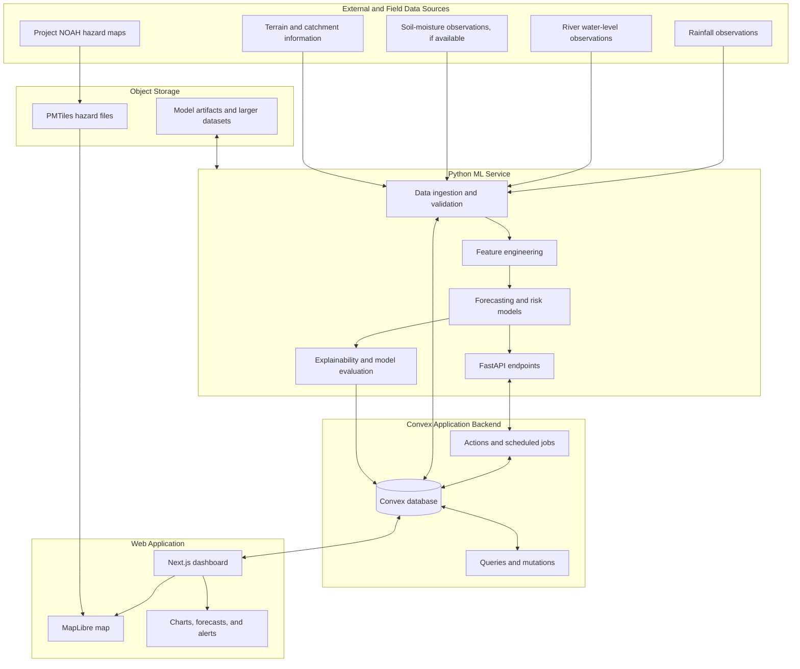
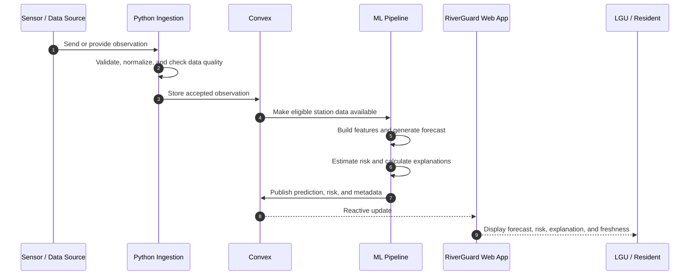

# RiverGuard

**Explainable Machine Learning for Hydrological Flood Risk and Water-Level Forecasting**

RiverGuard is a proposed web-based flood-monitoring and decision-support platform. It is designed to combine river and rainfall observations, historical geographic information, and machine-learning models to forecast near-future water levels and estimate localized flood risk.

The platform aims to help local government units (LGUs), disaster-risk reduction offices, and residents understand changing river conditions and make better-informed preparedness decisions.

> **Project status:** Early development / architecture stage. The repository currently contains a planned project structure and placeholder files. Forecasts, risk probabilities, alerts, and dashboard features described here are intended capabilities—not claims of an operational or validated warning system.

---

## Table of Contents

- [Project Goals](#project-goals)
- [Planned Features](#planned-features)
- [System Architecture](#system-architecture)
- [Technology Stack](#technology-stack)
- [Data Sources and Data Strategy](#data-sources-and-data-strategy)
- [Machine-Learning Approach](#machine-learning-approach)
- [Repository Structure](#repository-structure)
- [Development Setup](#development-setup)
- [Development Roadmap](#development-roadmap)
- [Important Limitations and Safety Considerations](#important-limitations-and-safety-considerations)
- [Contributing](#contributing)
- [License and Attribution](#license-and-attribution)

---

## Project Goals

RiverGuard is intended to address several limitations of static hazard maps and opaque predictive systems:

1. **Monitor changing conditions.** Bring available rainfall and river-level observations into a common monitoring interface.
2. **Forecast near-future water levels.** Estimate how river levels may change over configurable forecast horizons.
3. **Estimate localized risk.** Assess the probability of exceeding locally defined water-level or impact thresholds.
4. **Explain model outputs.** Show which input features contributed to an individual prediction, rather than presenting a probability without context.
5. **Support timely decisions.** Give LGU personnel and residents accessible information about station conditions, forecasts, data freshness, and warnings.
6. **Provide geographic context.** Display Project NOAH hazard layers alongside monitoring stations and model outputs.

RiverGuard is a decision-support tool. It is not intended to independently issue official evacuation orders or replace the authority of LGUs and relevant government agencies.

## Planned Features

### Monitoring dashboard

- Overview of monitored river stations.
- Latest available water levels and rainfall observations.
- Station status and data freshness indicators.
- Historical water-level and rainfall charts.
- Search and filtering by station, river, municipality, or barangay where data is available.

### Interactive hazard map

- MapLibre-based map interface.
- Project NOAH flood hazard layers for 5-, 25-, and 100-year return periods.
- Monitoring-station markers and station detail views.
- Optional overlays for forecast results and risk classifications.
- Layer controls, map legend, and source attribution.

### Forecasting and risk assessment

- Near-future water-level forecasts for supported monitoring stations.
- Risk estimates based on locally defined thresholds.
- Forecast horizon and model-version information.
- Prediction timestamps and input-data freshness.
- Clear indication when observations are missing, stale, or outside expected ranges.

### Explainability

- SHAP-based feature-contribution explanations where appropriate for the selected model.
- Human-readable summaries of influential inputs.
- Separation of model contribution from physical causation.
- Model evaluation and validation information available to authorized users.

### Alerts and administration

- Configurable station and threshold monitoring.
- Alert history and acknowledgement workflow.
- User roles for public users, LGU personnel, and system administrators.
- Administrative management of stations, data sources, and model versions.

All features above are planned. Their availability will depend on data access, implementation, and validation.

---

## System Architecture

The initial architecture is **Convex-first**. Convex is the primary application database and backend. A separate Python service handles data processing and machine learning. Large PMTiles files and model artifacts are stored in object storage rather than in Convex documents.



### Main component responsibilities

| Component | Responsibility |
|---|---|
| Next.js web application | Public interface, LGU dashboard, maps, charts, and administration UI |
| Convex | Application data, users, station metadata, readings, predictions, risk assessments, alerts, and reactive updates |
| Python / FastAPI | Data validation, feature engineering, model inference, explainability, and ML APIs |
| MapLibre GL JS | Interactive map rendering and hazard-layer visualization |
| PMTiles | Cloud-optimized vector-tile format for large static hazard maps |
| Object storage | Hosting PMTiles files, model artifacts, and other large files |

### Prediction workflow



---

## Technology Stack

| Area | Planned technology | Purpose |
|---|---|---|
| Frontend | Next.js | Web application and dashboard |
| Frontend language | TypeScript | Typed application code |
| UI and styling | Tailwind CSS, shadcn/ui | Layout and reusable interface components |
| Charts | Recharts | Rainfall and water-level visualizations |
| Mapping | MapLibre GL JS | Interactive geospatial display |
| Map data format | PMTiles | Efficient delivery of large vector-tile datasets |
| Application backend and database | Convex | Application data, queries, mutations, actions, and real-time subscriptions |
| ML language | Python | Data preparation, model training, and inference |
| ML API | FastAPI | HTTP interface for the ML service |
| Data processing | Pandas and NumPy | Cleaning and feature engineering |
| ML algorithms | Scikit-learn and XGBoost | Baseline forecasting and risk-classification models |
| Explainability | SHAP | Feature-contribution explanations |
| Object storage | Cloudflare R2 or compatible object storage | PMTiles, model files, and larger datasets |
| Testing | TypeScript tests, Pytest | Application and ML-service testing |

### Database strategy: Convex first

Convex is the primary database for the initial implementation. The project will not add PostgreSQL, PostGIS, or TimescaleDB by default.

Use Convex for:

- User profiles, roles, and LGU associations.
- Monitoring-station metadata.
- Sensor observations and station status.
- Forecasts and risk assessments.
- Alerts and acknowledgement records.
- Hazard-layer metadata and model-version metadata.

Use object storage for large PMTiles files and model artifacts. Do not store multi-gigabyte map files as Convex documents or commit them to Git.

A specialized database can be considered later if measured requirements justify it:

| Technology | Introduce it when |
|---|---|
| PostgreSQL | SQL-based analytics, reporting, or integrations require a separate relational store |
| PostGIS | Workloads require advanced spatial indexing, spatial joins, intersections, or watershed analysis that are unsuitable for the current application design |
| TimescaleDB | Historical sensor volume and time-series analytics exceed what is practical or cost-effective in the Convex-first design |

Any database migration or addition should be based on representative workload tests, query patterns, retention needs, and operational cost—not assumed scale.

---

## Data Sources and Data Strategy

RiverGuard needs both geographic context and time-stamped hydrological observations. These are different data categories and should not be treated as interchangeable.

### Project NOAH hazard maps

Initial map source:

- Dataset: [BetterGov.PH — Project NOAH Hazard Maps](https://huggingface.co/datasets/bettergovph/project-noah-hazard-maps)
- PMTiles directory: [Project NOAH PMTiles](https://huggingface.co/datasets/bettergovph/project-noah-hazard-maps/tree/main/PMTiles)
- Initial flood layers of interest: `flood_5yr.pmtiles`, `flood_25yr.pmtiles`, and `flood_100yr.pmtiles`.

These static hazard layers can provide baseline geographic context and show mapped flood-prone areas. They do **not** provide live water levels, rainfall observations, or near-future forecasts.

For local development, use the hosted PMTiles files where practical or keep downloaded copies outside Git. For deployment, host the required files in object storage that supports HTTP byte-range requests, then configure MapLibre to read them through the PMTiles protocol.

### Hydrological data required for forecasting

The ML system requires reliable, timestamped observations. Candidate data categories include:

- River or stream water levels, with station identifiers and measurement units.
- Rainfall measurements, with observation timestamps and station or geographic coverage.
- Soil-moisture observations, if available and sufficiently reliable.
- Historical flood occurrence or impact records for threshold selection and evaluation.
- River, catchment, elevation, and terrain attributes for geographic and hydrological context.
- Forecast rainfall, if a suitable source and integration are available.

The exact providers, access permissions, update frequency, coverage, and licensing for these data sources must be documented before model development relies on them.

### Data quality requirements

Each observation should preserve, where applicable:

- Source and station identifier.
- Observation timestamp and timezone convention.
- Measurement value and unit.
- Ingestion timestamp.
- Quality or validation status.
- Missing-data and sensor-status information.

Do not silently replace missing measurements with zero. Missing, stale, invalid, and estimated values must remain distinguishable throughout ingestion, model inference, and dashboard presentation.

---

## Machine-Learning Approach

The initial goal is to establish trustworthy baselines with structured environmental data before considering more complex models.

### Water-level forecasting

Start with supervised regression models using time-derived and environmental features, such as:

- Current and lagged water levels.
- Water-level change over recent intervals.
- Rolling rainfall totals over relevant windows.
- Antecedent rainfall indicators.
- Catchment, river, and terrain attributes.
- Soil moisture and forecast rainfall, when reliable data is available.

XGBoost regression and suitable Scikit-learn baselines are candidates for initial experiments. The forecast horizons and target stations should be defined from actual observation frequency and operational needs.

### Flood-risk estimation

Risk classification should be tied to locally meaningful outcomes, such as the probability of exceeding an established station-specific water-level threshold within a defined forecast horizon.

Avoid presenting an arbitrary model score as an official flood warning. Thresholds should be based on documented local references and reviewed with appropriate domain experts or authorities.

### Explainability

SHAP can be used to describe how input features contributed to an individual model prediction. These contributions explain model behavior; they do not establish that a feature physically caused a flood or water-level change.

### Model evaluation

Evaluation should use chronological or event-based splits rather than randomly mixing observations from the same time series across training and test sets.

Potential metrics include:

| Task | Evaluation measures |
|---|---|
| Water-level regression | MAE, RMSE, bias, and errors by forecast horizon and station |
| Risk classification | Precision, recall, F1, PR-AUC, and confusion matrix |
| Probability estimates | Calibration analysis and Brier score |
| Operational performance | Data freshness, missing-input behavior, inference latency, and alert lead time |

Model performance should be reported by station, event, and forecast horizon where sample sizes permit. A model should not be described as reliable for deployment until it has been validated against appropriate held-out observations and operational requirements.

---

## Repository Structure

```text
riverguard/
├── apps/
│   └── web/                    # Next.js application
├── convex/                     # Convex schema, queries, mutations, actions
├── services/
│   └── ml/                     # Python/FastAPI and model code
│       ├── app/
│       ├── tests/
│       ├── models/              # Local model artifacts; binary files stay out of Git
│       └── pyproject.toml
├── data/                       # Small development samples and schemas only
│   ├── samples/
│   └── schemas/
├── docs/
│   └── architecture/
│       └── riverguard-architecture.md
├── .env.example
├── .gitignore
└── README.md
```

The exact contents may evolve as the application is implemented. Generated files, local datasets, secrets, and trained binary artifacts should not be committed unless there is an explicit reason and an approved storage strategy.

---

## Development Setup

The repository is currently at the scaffold stage. The following are the expected prerequisites; exact install and run commands should be added once the application manifests and service entry points are implemented.

### Prerequisites

- Node.js LTS and a Node package manager.
- Python version supported by the ML service dependencies.
- A Convex account and development deployment.
- Access to the selected object-storage provider when hosting PMTiles or model artifacts.

### Configuration

1. Clone the repository.
2. Install the web application's dependencies after its `package.json` has been configured.
3. Install the Python ML service and its dependencies from `services/ml/pyproject.toml` after it has been populated.
4. Configure the required environment variables using `.env.example` as a template.
5. Configure the Convex deployment and its environment variables.
6. Configure the ML service URL and any authentication used for service-to-service requests.
7. Configure the PMTiles source URL and map attribution in the web application.

Never commit populated `.env` files, API keys, credentials, or production secrets.

### Environment variables

The exact variable names will be finalized during implementation. The project is expected to need configuration for:

- Convex deployment URL and application environment.
- Public web application URL.
- ML service URL and service authentication.
- PMTiles base URL or individual layer URLs.
- Object-storage credentials for server-side uploads, if required.

Only variables intentionally exposed to the browser should use the framework's public environment-variable prefix. Storage credentials and service secrets must remain server-side.

---

## Development Roadmap

### Phase 1 — Application foundation

- [ ] Initialize the Next.js application and TypeScript configuration.
- [ ] Configure Convex and establish the initial schema.
- [ ] Implement user roles and monitoring-station management.
- [ ] Build the initial dashboard layout.

### Phase 2 — Map integration

- [ ] Integrate MapLibre GL JS.
- [ ] Configure PMTiles protocol support.
- [ ] Display the 5-, 25-, and 100-year Project NOAH flood layers.
- [ ] Add station markers, map legend, layer controls, and attribution.

### Phase 3 — Observation data pipeline

- [ ] Identify accessible rainfall and river-level data sources.
- [ ] Document source licensing, coverage, units, and update frequency.
- [ ] Implement ingestion and validation.
- [ ] Store observations in Convex with appropriate indexes.
- [ ] Add historical charts and data-freshness indicators.

### Phase 4 — Forecasting and risk models

- [ ] Define forecast targets, horizons, and station-specific thresholds.
- [ ] Build reproducible feature-engineering pipelines.
- [ ] Establish baseline forecasting and classification models.
- [ ] Evaluate models using chronological and event-based validation.
- [ ] Add SHAP-based prediction explanations.

### Phase 5 — Alerts and operational validation

- [ ] Implement configurable alert rules and alert history.
- [ ] Add prediction metadata and stale-data safeguards.
- [ ] Validate warning workflows with relevant stakeholders.
- [ ] Test failure handling, monitoring, and deployment procedures.

---

## Important Limitations and Safety Considerations

- **Static maps are not forecasts.** Project NOAH hazard layers describe mapped hazard scenarios; they do not show current river conditions.
- **Predictions depend on data quality.** Missing, delayed, inaccurate, or poorly located sensors can produce unreliable outputs.
- **Probability is not certainty.** Risk estimates must be presented with their forecast horizon, threshold definition, data freshness, and model version.
- **Explainability is not causality.** SHAP feature contributions describe model behavior and should not be presented as proof of physical causation.
- **Human authority remains essential.** RiverGuard should support—not replace—official LGU and government warning, evacuation, and response procedures.
- **No unvalidated live warnings.** Do not expose experimental model outputs as operational public-safety warnings until the system has been adequately validated and approved for its intended use.

---

## Contributing

Contributions should keep data provenance, reproducibility, and public-safety implications in view.

Before submitting a change:

1. Keep data schemas and API contracts consistent across the web, Convex, and ML service.
2. Add or update tests for changed behavior.
3. Document external datasets, transformations, units, and licensing.
4. Avoid committing secrets, large datasets, PMTiles files, or model binaries.
5. Clearly label mock data and illustrative predictions so they cannot be mistaken for observations or validated forecasts.

For substantial architectural changes, update the relevant documentation under `docs/architecture/`.

---

## License and Attribution

The project's own source-code license has not yet been selected. Add a repository `LICENSE` file before distributing the application or accepting contributions under a stated license.

External datasets retain their own licenses and attribution requirements. In particular, review the [Project NOAH Hazard Maps dataset page](https://huggingface.co/datasets/bettergovph/project-noah-hazard-maps) and its ODbL terms before redistributing or adapting the data. Keep source attribution with the relevant map layer and document any derived datasets.

---

**RiverGuard — clearer hydrological insight for better-informed flood preparedness.**
