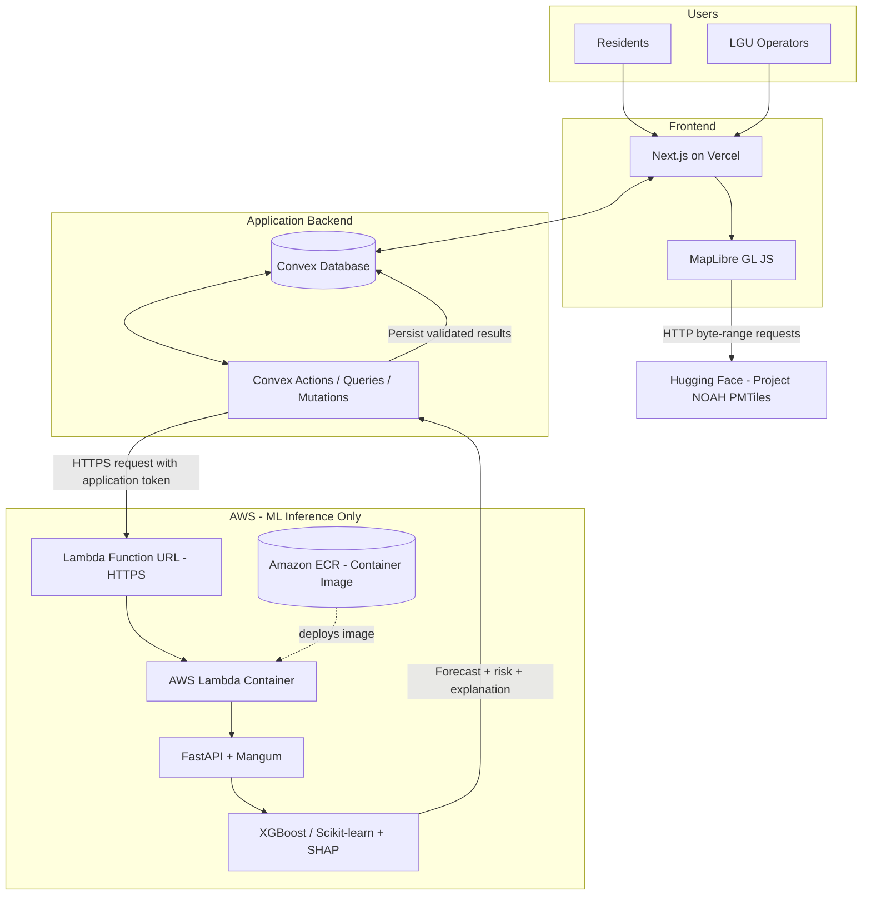
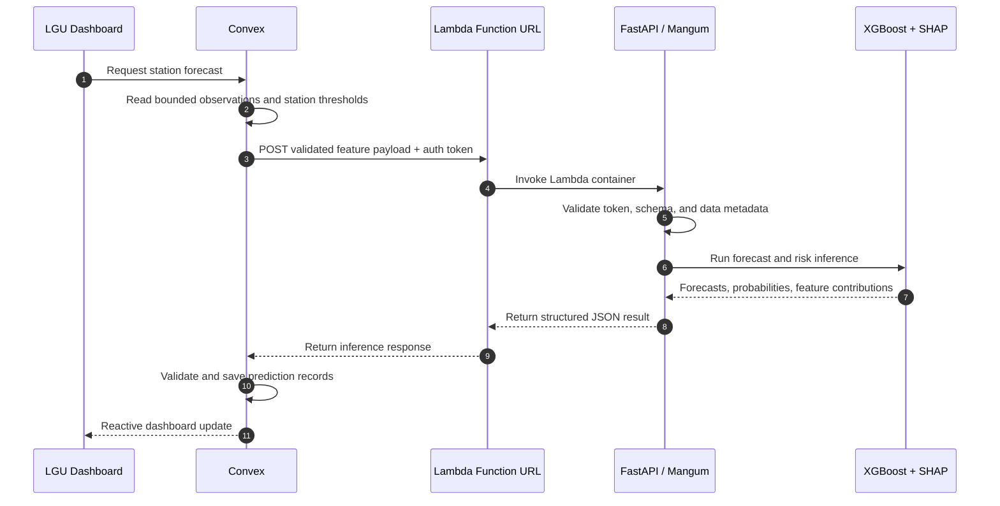
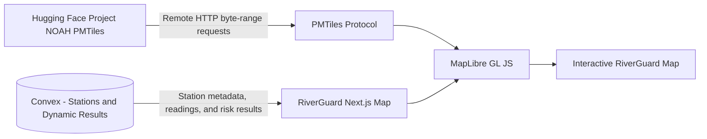

# RiverGuard

**Explainable Machine Learning for Hydrological Flood Risk and Water-Level Forecasting**

RiverGuard is a proposed web-based hydrological monitoring and flood-risk decision-support platform. It is designed to combine river-level and rainfall observations with geographic hazard information to forecast near-future water levels, estimate the likelihood of exceeding locally defined flood thresholds, and explain the factors that contribute to each model output.

The project is intended to support local government units (LGUs), disaster-risk reduction offices, and communities with clearer information about changing river conditions. RiverGuard is a decision-support system; it is not a replacement for official warnings, evacuation orders, or the authority of government agencies.

> **Project status:** Early development / architecture and implementation scaffold. Features described as planned are not necessarily implemented. No prediction, probability, or warning should be treated as operational or validated until the underlying data and models have been tested for their intended use.

---

## Table of Contents

- [Project Objectives](#project-objectives)
- [Planned Features](#planned-features)
- [Technology Stack](#technology-stack)
- [System Architecture](#system-architecture)
- [How the ML Service Works](#how-the-ml-service-works)
- [Database Strategy](#database-strategy)
- [Project NOAH Hazard Maps](#project-noah-hazard-maps)
- [Data Requirements](#data-requirements)
- [Machine-Learning Approach](#machine-learning-approach)
- [Repository Structure](#repository-structure)
- [Development Setup](#development-setup)
- [AWS Deployment and Credit Management](#aws-deployment-and-credit-management)
- [Development Roadmap](#development-roadmap)
- [Safety, Reliability, and Limitations](#safety-reliability-and-limitations)
- [Contributing](#contributing)
- [License and Attribution](#license-and-attribution)
- [References](#references)

---

## Project Objectives

RiverGuard aims to address limitations of static hazard maps and opaque predictive systems:

1. **Monitor changing hydrological conditions.** Bring available rainfall and river-level observations into a common monitoring interface.
2. **Forecast near-future water levels.** Estimate how water levels may change over selected forecast horizons.
3. **Estimate localized flood risk.** Calculate the probability of exceeding documented, locally relevant water-level thresholds.
4. **Explain model outputs.** Present feature contributions and relevant input conditions alongside forecasts instead of displaying an unexplained risk score.
5. **Provide geographic context.** Display Project NOAH flood hazard layers together with monitoring stations and RiverGuard forecasts.
6. **Support preparedness decisions.** Give authorized LGU users and the public access to information about station conditions, forecast horizons, data freshness, and warning status.

## Planned Features

### Monitoring dashboard

- Overview of configured river-monitoring stations.
- Latest available water-level and rainfall observations.
- Station status and data-freshness indicators.
- Historical water-level and rainfall charts.
- Search and filtering by station, river, municipality, or barangay when the required metadata is available.

### Interactive hazard map

- MapLibre GL JS map interface.
- Project NOAH flood hazard layers for 5-, 25-, and 100-year return-period scenarios.
- Monitoring-station markers and station detail panels.
- Optional forecast and risk overlays.
- Layer controls, legend, and dataset attribution.

### Forecasting and risk assessment

- Near-future water-level forecasts for supported stations.
- Risk estimates tied to locally documented thresholds and forecast horizons.
- Model version, prediction timestamp, and input-data freshness metadata.
- Clear handling of missing, stale, invalid, or out-of-range observations.

### Explainability

- SHAP-based feature-contribution explanations where appropriate for the selected model.
- Human-readable descriptions of influential input features.
- Clear distinction between model contribution and physical causation.
- Model evaluation information for authorized users.

### Alerts and administration

- Configurable station and threshold monitoring.
- Alert history and acknowledgement workflow.
- User roles for public users, LGU personnel, and system administrators.
- Administrative management of stations, data sources, and model versions.

All features above are planned capabilities. Their implementation and reliability depend on data availability, validation, and operational testing.

---

## Technology Stack

| Layer | Technology | Responsibility |
|---|---|---|
| Frontend | Next.js | Public interface and LGU dashboard |
| Frontend language | TypeScript | Typed frontend and Convex application code |
| UI and styling | Tailwind CSS, shadcn/ui | Styling and reusable interface components |
| Charts | Recharts | Rainfall, water-level, and forecast charts |
| Interactive maps | MapLibre GL JS | Hazard layers, station locations, and map overlays |
| Map archive format | PMTiles | Cloud-optimized vector-tile access |
| Hazard-map source | Hugging Face Project NOAH dataset | Remotely hosted baseline hazard layers |
| Application backend/database | Convex | Application records, queries, mutations, actions, and reactive updates |
| ML language | Python | Data processing, model training, and inference |
| ML API | FastAPI | HTTP API for model inference |
| Lambda adapter | Mangum | Adapts the ASGI/FastAPI application to AWS Lambda |
| ML compute | AWS Lambda | On-demand model inference |
| Container registry | Amazon ECR | Stores the Lambda container image |
| AWS permissions | IAM | Controls deployment and runtime permissions |
| AWS cost alerts | AWS Budgets | Notifies the project team about AWS spending |
| Data processing | Pandas, NumPy | Data cleaning and feature engineering |
| ML algorithms | Scikit-learn, XGBoost | Baseline regression and classification models |
| Explainability | SHAP | Feature-contribution explanations |
| Frontend hosting | Vercel | Next.js deployment |

The initial design deliberately keeps the number of infrastructure services small. AWS is used primarily to run the ML inference API. Convex remains the application's database and coordination backend.

---

## System Architecture

### High-level architecture



### Component responsibilities

| Component | Responsibility |
|---|---|
| Next.js on Vercel | Public interface, LGU dashboard, maps, charts, and administration UI |
| Convex | Users, station metadata, readings, predictions, risk assessments, alerts, and real-time application updates |
| Convex Actions | Coordinate forecast requests and communicate with the ML inference endpoint |
| FastAPI on AWS Lambda | Validate inference requests and execute model inference |
| Mangum | Connect FastAPI's ASGI interface to the Lambda runtime |
| XGBoost / Scikit-learn | Generate water-level forecasts and risk estimates |
| SHAP | Explain model feature contributions |
| Amazon ECR | Store versioned Lambda container images |
| IAM | Apply least-privilege AWS permissions |
| AWS Budgets | Send spending notifications for the available AWS credit |
| MapLibre GL JS | Render the interactive map in the user's browser |
| Hugging Face | Host the Project NOAH PMTiles archives used by the map |

### Forecast request and response workflow



### Project NOAH map-delivery workflow



### Future physical-sensor workflow

Physical sensor integration is a later phase and is not required for the initial web application or ML prototype.

```mermaid
flowchart LR
    SENSOR[River Monitoring Device]
    IOT[AWS IoT Core]
    SQS[Amazon SQS]
    INGEST[AWS Ingestion Lambda]
    CONVEX[Convex Ingestion Endpoint]
    DATA[(Convex Sensor Readings)]
    FORECAST[Convex Forecast Action]
    ML[AWS Lambda ML API]

    SENSOR -->|MQTT over TLS| IOT
    IOT --> SQS
    SQS --> INGEST
    INGEST -->|Authenticated HTTPS| CONVEX
    CONVEX --> DATA
    DATA --> FORECAST
    FORECAST --> ML
```



Only add AWS IoT Core and SQS after physical devices, message formats, sampling intervals, and device authentication requirements have been established.

---

## How the ML Service Works

The ML service is a stateless inference API. It does not act as a second application database.

1. A user requests a forecast through the Next.js application.
2. The frontend calls a Convex action.
3. Convex reads the required station configuration, thresholds, and a bounded window of historical measurements.
4. The Convex action sends a validated input payload to the AWS Lambda Function URL over HTTPS.
5. Lambda starts the FastAPI application through Mangum.
6. FastAPI validates the request and runs the packaged model artifacts.
7. The model returns forecast values and flood-threshold probabilities; SHAP produces feature-contribution explanations.
8. FastAPI returns a structured response to Convex.
9. Convex validates and stores the result, then updates subscribed dashboards.

### Example request payload

The following is an illustrative API contract. The final schema must be versioned and shared between Convex and the Python service.

```json
{
  "station_id": "station-001",
  "generated_at": "2026-10-30T08:00:00+08:00",
  "input_window": {
    "start": "2026-10-30T02:00:00+08:00",
    "end": "2026-10-30T08:00:00+08:00"
  },
  "measurements": [],
  "thresholds": [],
  "feature_schema_version": "v1"
}
```

This example does not represent actual observations or calibrated thresholds.

### Local development and AWS runtime

The FastAPI application should support two execution modes:

- **Local development:** Run the app with Uvicorn so developers can test endpoints without deploying to AWS.
- **AWS deployment:** Package the app and inference dependencies in a Lambda-compatible container image, expose a Mangum handler, and publish the image to Amazon ECR.

Model training should initially happen outside Lambda, such as on a developer machine or a separate research environment. Lambda should perform inference, not long-running model training. The first model artifact can be packaged inside the Lambda image. If model artifacts become too large or need frequent independent updates, reassess the storage and deployment design before adding another service.

---

## Database Strategy

### Convex-first approach

Convex is the primary and authoritative application database for the initial implementation. Do not introduce another database until a measured requirement justifies it.

Suggested application data:

| Data | Initial storage |
|---|---|
| User profiles and roles | Convex |
| LGU profiles and associations | Convex |
| Monitoring-station metadata | Convex |
| Sensor readings | Convex |
| Forecast records | Convex |
| Flood-risk assessments | Convex |
| Alerts and acknowledgement records | Convex |
| Hazard-layer metadata | Convex |
| Model-version metadata | Convex |
| Project NOAH PMTiles archives | Remain hosted on Hugging Face initially |
| Initial trained model artifact | Packaged in the Lambda container image |

Create indexes for the access patterns the application actually uses. For example, sensor readings should be queryable by station identifier and timestamp so forecast actions can retrieve a bounded time window efficiently. Use pagination and bounded queries rather than reading an entire station history in one transaction.

### When to consider another database

| Technology | Consider it only when |
|---|---|
| PostgreSQL | SQL analytics, reporting, or external integrations require a separate relational database |
| PostGIS | Advanced spatial joins, intersections, spatial indexing, or watershed analysis exceed the current design's needs |
| TimescaleDB | Sensor volume and time-series query patterns exceed what is practical or cost-effective in Convex |

Any database addition should be based on representative benchmarks, retention requirements, query patterns, and operational cost—not assumed future scale.

---

## Project NOAH Hazard Maps

Initial dataset:

- **Dataset:** [BetterGov.PH — Project NOAH Hazard Maps](https://huggingface.co/datasets/bettergovph/project-noah-hazard-maps)
- **Repository path:** `PMTiles/`
- **Relevant layers:** `flood_5yr`, `flood_25yr`, and `flood_100yr`
- **Format:** PMTiles vector-tile archives

### How RiverGuard uses the dataset

RiverGuard can load the hosted PMTiles archives directly from Hugging Face through the PMTiles JavaScript library and MapLibre GL JS. PMTiles supports HTTP byte-range access, allowing the browser to request the portions of an archive needed for the visible map instead of downloading the entire archive up front.

Initial approach:

1. Reference the hosted Project NOAH PMTiles URL in the web map configuration.
2. Register the PMTiles protocol with MapLibre.
3. Add the selected flood layer as a vector source.
4. Render the relevant source layer and documented classification attributes.
5. Display attribution and a legend that reflects the dataset's actual attributes.

Before relying on remote hosting, verify that the Hugging Face endpoint supports the browser's CORS requirements and HTTP byte-range responses. If the hosting behavior or availability changes, reassess the delivery approach rather than assuming the remote URL will always be suitable.

### Interpretation

The 5-, 25-, and 100-year labels refer to return-period scenarios, not predictions that a flood will occur exactly once every 5, 25, or 100 years. These static hazard maps provide geographic context; they are not real-time flood forecasts and should not be used as ML training labels without a separate, defensible data methodology.

### Dataset licensing

The Project NOAH dataset is distributed under the Open Data Commons Open Database License (ODbL), as stated by the dataset provider. Preserve required attribution and comply with applicable database and share-alike obligations when using, adapting, or redistributing the dataset. The RiverGuard proprietary license does not replace or override the dataset's license.

Do not commit multi-gigabyte PMTiles archives to the Git repository. The initial design uses the Hugging Face-hosted files directly.

---

## Data Requirements

Project NOAH hazard maps provide static geographical context. They do not provide the timestamped observations required to train and validate a water-level forecasting model.

RiverGuard will need reliable historical and/or live data such as:

- **River water levels:** Station identifier, timestamp, value, measurement unit, and sensor/source metadata.
- **Rainfall:** Timestamped rainfall measurements with station or geographic coverage.
- **Soil moisture:** Observations when a reliable source is available.
- **Flood occurrences and impacts:** Historical event records to support threshold definition and evaluation.
- **River and catchment characteristics:** River geometry, catchment attributes, elevation, and terrain information where available.
- **Forecast rainfall:** Forecast inputs when an appropriate provider and integration are available.

The availability, access permissions, update frequency, geographic coverage, quality, and licensing of these data sources must be confirmed before model development depends on them.

### Data-quality requirements

Each observation should preserve, where applicable:

- Source and station identifier.
- Observation timestamp and timezone convention.
- Measurement value and unit.
- Ingestion timestamp.
- Quality or validation status.
- Missing-data and sensor-status information.

Do not silently replace missing measurements with zero. Missing, stale, invalid, and estimated values must remain distinguishable throughout ingestion, inference, and dashboard presentation.

---

## Machine-Learning Approach

Begin with interpretable, reproducible baselines using structured environmental data. Avoid introducing complex deep-learning models before the quantity and quality of available observations are understood.

### Water-level forecasting

Candidate input features include:

- Current and lagged water levels.
- Water-level change over recent intervals.
- Rolling rainfall totals over relevant windows.
- Antecedent rainfall indicators.
- Catchment, river, elevation, and terrain attributes.
- Soil moisture and forecast rainfall when reliable observations are available.

XGBoost regression and suitable Scikit-learn baselines are candidates for initial forecasting experiments. Forecast horizons must be selected based on observation frequency, data availability, and operational needs.

### Flood-risk estimation

Risk estimates should target a documented outcome, such as the probability of exceeding a station-specific water-level threshold within a defined forecast horizon. Avoid presenting an arbitrary model score as a flood probability or official warning.

Thresholds should be based on documented local references and reviewed with appropriate hydrological and disaster-risk stakeholders.

### Explainability

SHAP can describe how input features contributed to an individual model prediction. Feature contributions explain model behavior; they do not prove that a feature physically caused a flood or water-level change.

### Model evaluation

Use chronological or event-based splits. Do not randomly mix observations from the same time series or storm event across training and test sets.

| Task | Candidate evaluation measures |
|---|---|
| Water-level regression | MAE, RMSE, bias, and error by forecast horizon and station |
| Risk classification | Precision, recall, F1, PR-AUC, and confusion matrix |
| Probability estimates | Calibration analysis and Brier score |
| Operational behavior | Data freshness, missing-input handling, inference latency, and useful alert lead time |

Report results by station, event, and forecast horizon where sample sizes permit. Do not describe a model as reliable for operational deployment until it has been validated against appropriate held-out observations and the intended operating conditions.

---

## Repository Structure

The repository is organized to separate the web application, Convex backend, Python ML service, data contracts, and documentation.

```text
riverguard/
├── apps/
│   └── web/                         # Next.js application
│       └── src/
│           ├── app/                  # App Router pages and layouts
│           ├── components/           # Dashboard, map, charts, stations, alerts
│           ├── lib/                  # Client utilities and API helpers
│           └── types/                # Frontend TypeScript types
├── convex/                           # Convex schema, queries, mutations, actions
├── services/
│   └── ml/                            # Python/FastAPI and model code
│       ├── app/
│       │   ├── api/                   # FastAPI route handlers
│       │   ├── core/                  # Settings and configuration
│       │   ├── schemas/               # Request and response models
│       │   └── services/              # Features, forecasting, risk, explainability
│       ├── tests/                     # ML API and service tests
│       ├── models/                    # Model artifacts (do not commit large binaries)
│       ├── Dockerfile                 # Lambda-compatible container image
│       └── pyproject.toml             # Python dependencies and tooling
├── data/
│   ├── samples/                       # Small, synthetic or approved sample data
│   └── schemas/                       # Data contract/schema definitions
├── docs/
│   ├── architecture/
│   │   └── riverguard-architecture.md
│   ├── data-sources.md
│   └── ml-methodology.md
├── .env.example
├── .gitignore
├── LICENSE
└── README.md
```

The exact contents may evolve. Generated files, local datasets, credentials, PMTiles archives, and large model binaries should not be committed without an explicit reason and an approved storage strategy.

---

## Development Setup

The repository may initially contain scaffold or placeholder files. The steps below describe the intended development workflow; package manifests and application entry points must be populated before all commands can run successfully.

### Prerequisites

- Git.
- Node.js LTS and npm.
- Python version selected and pinned by the ML service's `pyproject.toml`.
- Docker Desktop or another Docker-compatible runtime for building the Lambda container image.
- A Convex account and development deployment.
- A Vercel account for frontend deployment.
- An AWS account with the project's available credit, if deploying the ML service to AWS.
- AWS CLI configured with a least-privilege deployment identity for the relevant AWS account.

### Clone the repository

```bash
git clone <YOUR_REPOSITORY_URL>
cd riverguard
```

### Web application

After `apps/web/package.json` is configured:

```bash
cd apps/web
npm install
npm run dev
```

The web application will normally be available at `http://localhost:3000`.

### Convex

After the Convex project is configured and the required dependencies are installed:

```bash
npx convex dev
```

Configure the Convex deployment URL and server-side environment variables in the appropriate local and deployment environments. Do not expose private ML credentials through browser-visible environment variables.

### Python ML service

After `services/ml/pyproject.toml` is populated, create and activate a virtual environment, then install the project dependencies using the selected Python package manager.

Example using a standard virtual environment:

```bash
cd services/ml
python -m venv .venv

# Windows PowerShell
.venv\Scripts\Activate.ps1

# Linux / macOS
# source .venv/bin/activate
```

Install the project and its dependencies according to the package manager and configuration selected for `pyproject.toml`.

For local development, run FastAPI with Uvicorn once `app.main:app` is implemented:

```bash
uvicorn app.main:app --host 127.0.0.1 --port 8000 --reload
```

The local API should expose a health endpoint for development checks. The production Lambda container should use the Mangum handler rather than the local Uvicorn command as its Lambda entry point.

### Environment configuration

Use `.env.example` to document variable names without including real secrets. Expected configuration includes:

| Variable / setting | Used by | Purpose |
|---|---|---|
| `CONVEX_DEPLOYMENT` | Convex tooling | Selects the development or deployment environment |
| `NEXT_PUBLIC_CONVEX_URL` | Next.js browser client | Convex deployment URL intended to be public |
| `NEXT_PUBLIC_NOAH_*_PMTILES_URL` | Next.js map | Public remote PMTiles URLs for the selected Project NOAH layers |
| `ML_SERVICE_URL` | Convex server-side action | Lambda Function URL for the ML inference API |
| `ML_SERVICE_TOKEN` | Convex and Lambda | Shared server-to-server bearer token; keep secret |
| `AWS_REGION` | Deployment tooling | AWS region selected for the Lambda and ECR resources |

Names may be adjusted to match the final implementation. Only variables explicitly designed for browser use should use the Next.js public environment-variable prefix. Never expose the ML token, AWS credentials, or deployment secrets to browser code or commit them to Git.

---

## AWS Deployment and Credit Management

The project has a limited **US$130 AWS credit balance**. AWS usage must be kept minimal and reviewed regularly. The AWS credit is not a guarantee that all charges will be covered: eligibility, expiration, region, service, tax, and promotional-credit conditions depend on the terms shown in the AWS account.

### Initial AWS services

| Service | Purpose | Initial scope |
|---|---|---|
| AWS Lambda | Runs the FastAPI inference application on demand | One function using a Lambda-compatible container image |
| Amazon ECR | Stores the versioned Lambda container image | One private repository with image cleanup rules |
| IAM | Controls runtime and deployment permissions | Least-privilege execution and deployment roles |
| AWS Budgets | Sends cost notifications | One conservative budget with email alerts |

### Services deliberately not included initially

- No dedicated cloud logging or monitoring service configuration.
- No Cloudflare R2, Amazon S3, or separate object-storage bucket.
- No CloudFront or separate CDN for hazard maps.
- No ECS or Fargate for an always-running ML container.
- No API Gateway; use a Lambda Function URL for the initial inference endpoint.
- No RDS, Aurora, DynamoDB, PostgreSQL, PostGIS, or TimescaleDB; Convex remains the application database.
- No AWS IoT Core or SQS until physical sensors and their ingestion requirements are confirmed.
- No EventBridge initially; use Convex scheduled functions for application-level scheduling.

### Initial deployment design

1. Build the FastAPI service as a Lambda-compatible container image.
2. Include the initial inference model artifact and production dependencies in the image.
3. Push the image to the project's private Amazon ECR repository.
4. Create an AWS Lambda function from the ECR image.
5. Configure a Lambda Function URL for HTTPS invocation.
6. Configure the function's memory, timeout, and concurrency conservatively based on tests.
7. Store the ML authentication token as a server-side Lambda environment variable and in Convex's server-side environment configuration.
8. Configure an AWS Budget and cost notifications before repeated deployment or load testing.

The Lambda Function URL is publicly addressable when configured with unauthenticated URL invocation. The application must validate a strong bearer token on every request; the URL itself is not a secret. Keep the token out of frontend code. For a future stronger AWS-native authentication design, evaluate IAM-authenticated Function URLs and AWS Signature Version 4 request signing from the Convex server side.

### Cost-control practices

- Start with one Lambda function and one ECR repository.
- Do not enable provisioned concurrency for the prototype.
- Set a conservative reserved-concurrency limit to reduce unexpected invocation volume.
- Keep the container image small and remove old, unneeded images.
- Package only inference dependencies and the model artifact; exclude notebooks, training datasets, and development tools.
- Train models locally or in a separate research environment; use Lambda for inference.
- Avoid attaching Lambda to a customer VPC unless a demonstrated requirement exists. VPC networking can introduce additional configuration and charges.
- Avoid long-running or high-volume load tests until costs and limits are understood.
- Configure AWS Budgets alerts at conservative thresholds, for example 50%, 80%, and 100% of a chosen monthly target, and review actual billing regularly.
- Remember that budget alerts are notifications, not hard spending caps, and billing data may be delayed.
- Check the current AWS pricing and the exact credit terms in the account before deployment.

AWS Lambda has request and compute free-tier allowances under applicable pricing terms, but eligibility and credit coverage can vary. Do not assume the RiverGuard deployment will remain free or that the US$130 credit will cover all experiments. Actual costs depend on region, memory allocation, execution duration, request count, data transfer, image storage, and credit eligibility.

### Lambda suitability and limitations

Lambda is intended for bounded inference requests, not persistent workers or long-running model training. Cold starts can add latency, especially with large Python dependencies or model artifacts. Benchmark cold-start time, warm execution time, memory consumption, and prediction latency using representative station payloads before using the service for time-sensitive workflows.

If inference becomes too slow, needs persistent workers, or requires long-running processing, benchmark alternatives such as a managed container service before changing the architecture. Do not move to a continuously running service solely on the assumption that it will be faster or more reliable.

---

## Development Roadmap

### Phase 1 — Data Acquisition & Exploration (Critical Path)
- [ ] Secure historical rainfall and river-level CSV data (e.g., via DOST-ASTI PhilSensors or PAGASA).
- [ ] Document source licensing, coverage, measurement units, and update frequency.
- [ ] Clean the dataset (handle missing data, NaNs, and timezone alignment) locally.
- [ ] **Go/No-Go Decision:** Do not proceed to web development until a working, clean dataset spanning multiple years is secured.

### Phase 2 — Local ML Prototyping
- [ ] Define forecast targets, horizons, and station-specific thresholds based on the acquired data.
- [ ] Build reproducible feature-engineering pipelines in a local Python environment.
- [ ] Train baseline XGBoost/Scikit-learn models on local machines.
- [ ] Generate local SHAP plots to verify explainability outputs.
- [ ] Evaluate models using chronological train-test splits (target metrics: RMSE, MAE).

### Phase 3 — Application Foundation
- [ ] Initialize the Next.js application and TypeScript configuration.
- [ ] Configure Convex and implement the initial schema.
- [ ] Ingest the cleaned CSV observations into Convex with indexes for station/time queries.
- [ ] Build the initial dashboard layout (historical charts and data-freshness indicators).

### Phase 4 — API Integration & Simplified Hosting
- [ ] Wrap the working XGBoost and SHAP models into a FastAPI application.
- [ ] Keep FastAPI runnable locally through Uvicorn for frontend testing.
- [ ] Deploy the FastAPI service (evaluate simplified PaaS providers like Render/Railway first to save time, or proceed with AWS Lambda/Mangum only if required).
- [ ] Connect Convex actions to the deployed ML endpoint.

### Phase 5 — Project NOAH Map & Explainability UI
- [ ] Integrate MapLibre GL JS and load remotely hosted Project NOAH PMTiles.
- [ ] Render the SHAP force plots and risk classifications on the Next.js dashboard.
- [ ] Add station markers, map legend, layer controls, and attribution.

### Phase 6 — Alerts and Operational Validation
- [ ] Implement configurable alert rules and alert history in Convex.
- [ ] Test service failures, missing observations, and deployment rollback.
- [ ] Validate warning workflows with relevant stakeholders (or academic advisers).

---

## Safety, Reliability, and Limitations

- **Static maps are not forecasts.** Project NOAH hazard layers describe mapped hazard scenarios; they do not show current river conditions.
- **Return periods are not schedules.** A 100-year return-period scenario does not mean a flood occurs exactly once every 100 years.
- **Predictions depend on input quality.** Missing, delayed, inaccurate, or poorly located sensors can lead to unreliable outputs.
- **Probability is not certainty.** Risk estimates must identify the target threshold, forecast horizon, data freshness, and model version.
- **Explainability is not causality.** SHAP contributions describe model behavior and do not prove physical causation.
- **Cold starts and outages matter.** On-demand serverless inference may have startup latency or temporary unavailability. This must be evaluated before any time-critical use.
- **Human authority remains essential.** RiverGuard supports decision-making; it does not independently issue official evacuation orders or replace LGUs and relevant government agencies.
- **No unvalidated live warnings.** Experimental predictions must not be presented as operational public-safety warnings until the data, models, infrastructure, and response procedures have been adequately validated.

---

## Contributing

RiverGuard is proprietary software. Contributions are accepted only from people authorized by the project owner or organization.

Authorized contributors should:

1. Keep data schemas and API contracts consistent across the web application, Convex, and ML service.
2. Add or update tests for changed behavior.
3. Document data provenance, transformations, measurement units, and licensing.
4. Avoid committing secrets, large datasets, PMTiles files, or large model binaries.
5. Clearly label mock data and illustrative predictions so they cannot be mistaken for observations or validated forecasts.
6. Update the relevant documentation under `docs/` when changing architecture or data contracts.

Submitting a contribution does not grant permission to independently redistribute or commercialize RiverGuard. Contribution ownership and rights should be covered by a written agreement with the project owner where appropriate.

---

## License and Attribution

### RiverGuard proprietary software

RiverGuard is proprietary software. **All rights are reserved.** Use, copying, modification, redistribution, publication, sublicensing, or commercial exploitation of RiverGuard's original source code and protected project assets requires prior written permission from the copyright owner, except where otherwise permitted by applicable law.

Repository access does not grant a license to reuse, republish, modify, distribute, or commercialize RiverGuard. See the [`LICENSE`](LICENSE) file for the complete notice and contact information.

### Third-party software and datasets

Third-party components and datasets are not automatically covered by RiverGuard's proprietary notice. They remain subject to their own licenses and terms:

- **Project NOAH Hazard Maps:** The dataset is identified by its provider as being subject to the Open Data Commons Open Database License (ODbL). Preserve required attribution and comply with applicable share-alike obligations.
- **Software dependencies:** Next.js, Convex, MapLibre GL JS, FastAPI, Mangum, XGBoost, Scikit-learn, SHAP, and other dependencies retain their respective licenses.
- **Additional datasets:** Any external dataset retains its original ownership, license, access restrictions, and attribution requirements.

RiverGuard's proprietary license does not override third-party licenses or grant ownership of third-party materials.

---

## References

### Project NOAH

- [BetterGov.PH — Project NOAH Hazard Maps on Hugging Face](https://huggingface.co/datasets/bettergovph/project-noah-hazard-maps)
- [Hugging Face PMTiles directory](https://huggingface.co/datasets/bettergovph/project-noah-hazard-maps/tree/main/PMTiles)

### Core technologies

- [Next.js documentation](https://nextjs.org/docs)
- [Convex documentation](https://docs.convex.dev/)
- [MapLibre GL JS documentation](https://maplibre.org/maplibre-gl-js/docs/)
- [PMTiles documentation](https://docs.protomaps.com/pmtiles/)
- [FastAPI documentation](https://fastapi.tiangolo.com/)
- [Mangum documentation](https://mangum.fastapiexpert.com/)
- [XGBoost documentation](https://xgboost.readthedocs.io/)
- [SHAP documentation](https://shap.readthedocs.io/)

### AWS

- [AWS Lambda documentation](https://docs.aws.amazon.com/lambda/latest/dg/welcome.html)
- [Create a Lambda function using a container image](https://docs.aws.amazon.com/lambda/latest/dg/images-create.html)
- [Lambda Function URLs](https://docs.aws.amazon.com/lambda/latest/dg/urls-configuration.html)
- [Lambda Function URL authentication](https://docs.aws.amazon.com/lambda/latest/dg/urls-auth.html)
- [Amazon ECR documentation](https://docs.aws.amazon.com/AmazonECR/latest/userguide/what-is-ecr.html)
- [IAM documentation](https://docs.aws.amazon.com/iam/)
- [AWS Budgets documentation](https://docs.aws.amazon.com/cost-management/latest/userguide/budgets-managing-costs.html)
- [AWS Lambda pricing](https://aws.amazon.com/lambda/pricing/)
- [Amazon ECR pricing](https://aws.amazon.com/ecr/pricing/)

---

**RiverGuard — Explainable Machine Learning for Hydrological Flood Risk and Water-Level Forecasting**
