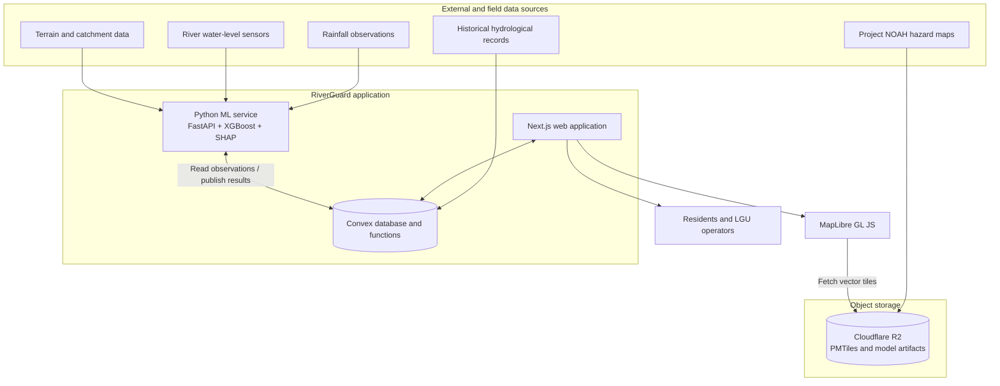
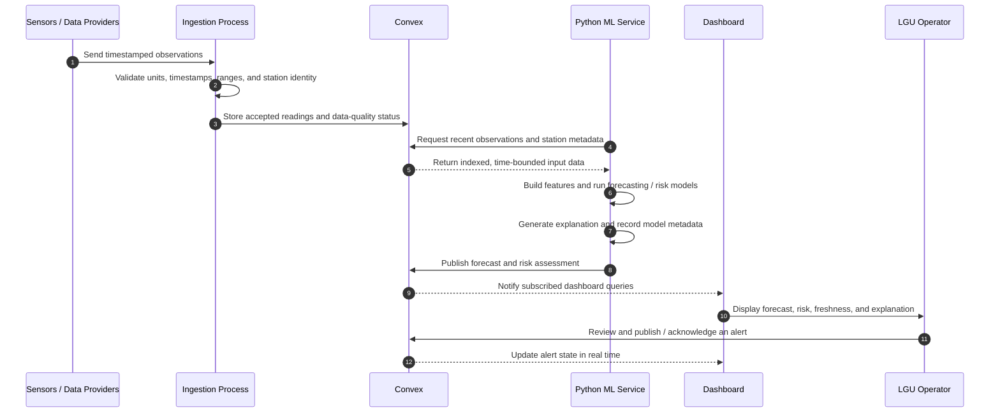
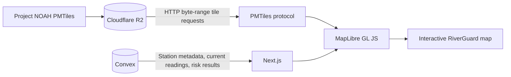

# RiverGuard — Technical Architecture

> **Status:** Proposed initial architecture  
> **Architecture principle:** Start with Convex as the primary application database. Add specialized infrastructure only when a measured requirement justifies it.

## 1. Project overview

RiverGuard is a web-based, explainable flood-risk monitoring and forecasting system. It is intended to help local government units (LGUs) and residents understand changing river conditions through near-future water-level forecasts, localized flood-risk estimates, interactive hazard maps, and timely warnings.

The initial system is designed around four capabilities:

1. **Hazard-map visualization** — display Project NOAH hazard layers alongside monitoring stations and current risk information.
2. **Hydrological data management** — collect, validate, and store time-stamped rainfall and water-level observations.
3. **Forecasting and risk assessment** — use historical and current observations to forecast water levels and estimate the probability of exceeding locally defined thresholds.
4. **Explainable warnings** — show the factors that contributed to a model result and provide LGU operators with tools to review and publish alerts.

The Project NOAH hazard maps provide static or baseline hazard context. They are not, by themselves, a time-series dataset and are not sufficient to train a model that forecasts changing water levels. Forecasting requires time-stamped hydrological observations and suitable historical records.

## 2. Architecture decision

### 2.1 Use Convex as the initial primary database

RiverGuard will use **Convex for application data and real-time application updates**. The initial implementation will not require a separate PostgreSQL, PostGIS, or TimescaleDB deployment.

Convex will store and manage:

- Users, roles, and LGU profiles.
- Monitoring-station metadata.
- Sensor observations and their quality/status metadata.
- Forecast results and risk assessments.
- Alerts and alert acknowledgements.
- Hazard-layer metadata and references to externally hosted map files.
- Model-version metadata and evaluation summaries.

Convex's indexed queries and reactive subscriptions are appropriate for the initial dashboard and monitoring workflows. The application should use indexes for its main access patterns and paginate historical readings instead of loading unbounded datasets into a single query.

### 2.2 Keep large geospatial files outside Convex

Large PMTiles files and other static geospatial assets should be stored in object storage, such as **Cloudflare R2**, rather than in Convex documents or file storage.

The web client will use **MapLibre GL JS** to render the map and the **PMTiles protocol** to request only the tile data needed for the current view. The object-storage endpoint must support HTTP byte-range requests so that PMTiles can be accessed efficiently.

Convex stores metadata and references for these assets; it does not serve the large tile archive.

### 2.3 Keep machine learning in a Python service

The forecasting and explainability code will live in a separate **Python service**, initially exposed through **FastAPI**. This keeps the ML environment independent of the frontend and Convex application functions.

The Python service is responsible for:

- Preparing and validating model input data.
- Creating time-window and hydrological features.
- Running water-level forecasting models.
- Estimating flood-threshold exceedance probabilities.
- Producing SHAP-based feature-contribution explanations where appropriate.
- Recording model version, prediction time, input-data time range, and data-quality information with each prediction.

The service will read required observations from Convex through an authenticated integration and publish forecasts and risk assessments back through an authenticated Convex endpoint/function. The integration mechanism should be implemented using the currently supported Convex HTTP/function APIs; credentials must remain server-side.

## 3. Recommended technology stack

| Layer | Technology | Responsibility |
|---|---|---|
| Web application | Next.js | Public interface and LGU dashboard |
| Language | TypeScript | Frontend and Convex application code |
| UI styling | Tailwind CSS | Layout and styling |
| UI components | shadcn/ui | Reusable dashboard components |
| Charts | Recharts | Rainfall, water-level, and forecast charts |
| Interactive maps | MapLibre GL JS | Hazard layers, stations, rivers, and risk overlays |
| Map archive format | PMTiles | Cloud-optimized vector-tile distribution |
| Application database | Convex | Application records, observations, predictions, alerts, and live updates |
| ML/API service | Python + FastAPI | Data processing, model inference, and ML endpoints |
| Data processing | Pandas + NumPy | Data cleaning and feature engineering |
| Initial ML models | Scikit-learn + XGBoost | Regression and classification baselines |
| Explainability | SHAP | Feature-contribution explanations |
| Object storage | Cloudflare R2 | PMTiles archives and model artifacts |
| Web deployment | Vercel or equivalent | Next.js hosting |
| Python deployment | A managed Python/container host | FastAPI hosting and scheduled inference jobs |

This is an intentionally lean initial stack. Do not introduce a message broker, Kubernetes, or a separate microservice for every capability unless operational requirements later demonstrate a need.

## 4. System architecture

### 4.1 High-level component diagram



### 4.2 Prediction and alert workflow



### 4.3 Data-to-map rendering workflow



## 5. Data ownership and storage boundaries

Use one clear owner for each category of data. This avoids unnecessary duplication and keeps the application easier to maintain.

| Data category | Initial storage | Notes |
|---|---|---|
| Users and roles | Convex | Apply role-based authorization to all privileged operations. |
| LGU profiles | Convex | Associate users, stations, and alert permissions with the appropriate LGU. |
| Monitoring stations | Convex | Store station identifier, name, coordinates, river/basin association, units, and operational status. |
| Sensor readings | Convex | Store timestamped observations with source and quality metadata. Use indexed, bounded queries. |
| Forecasts | Convex | Store forecast horizon, predicted level, generation time, model version, and input-data window. |
| Risk assessments | Convex | Store threshold, estimated exceedance probability, risk category, and explanation metadata. |
| Alerts | Convex | Store alert status, severity, affected area/stations, timestamps, issuer, and acknowledgement history. |
| Hazard-layer metadata | Convex | Store layer names, descriptions, attribution, source, and object-storage references. |
| PMTiles archives | Cloudflare R2 | Keep large static map files out of Convex. |
| Trained model artifacts | Cloudflare R2 | Store versioned model files and associated metadata. |
| Spatial reference data | Initially Convex metadata + static map layers | Use a separate spatial database only if advanced spatial querying becomes a real requirement. |

### 5.1 Suggested Convex tables

The following is a logical starting point, not a requirement to implement every table immediately.

| Table | Example fields | Purpose |
|---|---|---|
| `users` | `name`, `email`, `role`, `lguId` | User identity and authorization metadata |
| `lgu_profiles` | `name`, `region`, `province`, `municipality` | LGU organization information |
| `monitoring_stations` | `stationCode`, `name`, `latitude`, `longitude`, `riverName`, `status`, `waterLevelUnit` | Station registry and location metadata |
| `sensor_readings` | `stationId`, `timestamp`, `waterLevel`, `rainfall`, `soilMoisture`, `source`, `qualityStatus` | Time-stamped sensor and weather observations |
| `predictions` | `stationId`, `generatedAt`, `horizonMinutes`, `targetTimestamp`, `predictedWaterLevel`, `modelVersion`, `inputWindow` | Forecast results |
| `risk_assessments` | `stationId`, `generatedAt`, `thresholdId`, `exceedanceProbability`, `riskCategory`, `modelVersion`, `explanation` | Flood-threshold risk estimates and explanations |
| `risk_thresholds` | `stationId` or `locationId`, `name`, `waterLevel`, `unit`, `source`, `effectiveFrom` | Locally established warning thresholds and provenance |
| `alerts` | `stationId`, `locationId`, `severity`, `status`, `message`, `createdAt`, `issuedBy` | Warning lifecycle and operator actions |
| `hazard_layers` | `name`, `hazardType`, `source`, `attribution`, `tileUrl`, `format`, `enabled` | Metadata for externally hosted map layers |
| `model_versions` | `modelName`, `version`, `artifactUrl`, `trainedAt`, `metrics`, `featureSchemaVersion` | Model registry metadata and evaluation results |

### 5.2 Important index and query patterns

For `sensor_readings`, the primary historical access pattern is retrieving a bounded time range for one station. Define a compound index equivalent to:

```typescript
.index("by_station_timestamp", ["stationId", "timestamp"])
```

Use the index to query one station and a time range. Add other indexes only for demonstrated query patterns, such as retrieving alerts by status and creation time or predictions by station and generation time.

Implementation guidelines:

- Always bound historical queries by station and time range where possible.
- Paginate older readings and historical records.
- Do not fetch an entire station history for every dashboard render.
- Keep frequently displayed latest-value summaries separate from large historical result sets when that improves query efficiency.
- Define a retention and archival policy before sensor volume becomes large.
- Preserve units, source timestamps, ingestion timestamps, and quality flags. Do not silently mix measurements with different units or sampling intervals.

## 6. Machine learning design

### 6.1 Start with a measurable baseline

Begin with conventional supervised-learning models for structured hydrological observations. Avoid starting with a deep-learning architecture unless the available dataset size, sampling frequency, and validation results justify it.

Recommended initial approach:

- **Water-level forecasting:** XGBoost regression as a baseline, evaluated against persistence and simple statistical baselines.
- **Flood-threshold classification:** Scikit-learn or XGBoost classification for the probability of exceeding a defined local water-level threshold within a specified forecast horizon.
- **Explainability:** SHAP feature contributions for supported model types, accompanied by clear descriptions of the input window and data freshness.

### 6.2 Candidate input features

Candidate features should be selected based on actual data availability and quality:

- Current and lagged water-level measurements.
- Water-level change over recent intervals.
- Rolling rainfall totals (for example, 1-hour, 3-hour, 6-hour, and 24-hour windows).
- Recent and forecast rainfall, where a reliable forecast source is available.
- Soil-moisture observations, where measured and sufficiently reliable.
- Station, river, and catchment characteristics.
- Elevation, slope, and other terrain-derived attributes.
- Relevant upstream station measurements, where hydrological connectivity and timing are established.

Do not treat unavailable inputs as if they were measured. Track missingness and input quality, and define what the model should do when required inputs are stale or absent.

### 6.3 Forecast and risk outputs

Keep water-level forecasts and flood-risk probabilities conceptually separate.

A water-level forecast might provide a predicted value at several horizons (for example, 1, 2, and 3 hours). A risk model might estimate the probability of exceeding a station-specific threshold within a stated horizon.

Every output should identify:

- Station and location.
- Forecast generation timestamp.
- Target timestamp or forecast horizon.
- Predicted water level and unit, where applicable.
- Threshold and threshold source, where applicable.
- Estimated probability and risk category, where applicable.
- Model name and version.
- Input-data time window and freshness.
- Data-quality warnings or missing-input indicators.
- Explanation method and feature contributions, when available.

Probability values must be validated and calibrated against held-out historical events. A probability is not a certainty and should not be presented as one.

### 6.4 Explainability limitations

SHAP can describe how input features contributed to a particular model output. It does not prove that a feature physically caused the observed or forecasted flood condition. Present explanations as model explanations, not causal conclusions.

### 6.5 Model evaluation

Use time-aware validation. Do not randomly split adjacent observations from the same storm event across training and test sets, because that can produce misleadingly optimistic results.

Suggested metrics:

| Task | Evaluation |
|---|---|
| Water-level regression | MAE, RMSE, and error by forecast horizon and station |
| Threshold classification | Precision, recall, F1, precision-recall AUC, and confusion matrix |
| Probability estimates | Calibration curve and a suitable probability scoring metric |
| Operational warning performance | Lead time, missed events, false alarms, and data availability |

Compare model results with simple baselines. Report performance by station, event, forecast horizon, and relevant data-quality conditions where the dataset permits.

## 7. Geospatial implementation

### 7.1 Map rendering

Use MapLibre GL JS for the interactive map and PMTiles for distribution of the Project NOAH vector-tile archive.

The map can display:

- Project NOAH flood-hazard layers and other available hazard layers.
- Monitoring-station markers and station status.
- Current water-level readings.
- Forecast summaries and risk categories.
- Barangay or administrative boundaries, where available.
- User-selected layers and legends.

Store the PMTiles archive in Cloudflare R2 or compatible object storage. Configure public or appropriately secured tile access and ensure HTTP byte-range support. Store the archive URL and attribution information in Convex as metadata.

### 7.2 Rendering is not spatial analysis

MapLibre rendering a hazard layer does not mean the application can perform every spatial query against that layer. If RiverGuard later needs server-side point-in-polygon tests, watershed intersections, spatial joins, or large-scale geospatial analysis, evaluate a dedicated geospatial processing workflow. This could initially use Python geospatial libraries and, if query complexity or volume warrants it, PostGIS.

### 7.3 Hazard-map interpretation

Project NOAH hazard layers should be described as baseline or reference hazard information, with their source and assumptions visible to users. Do not present a static return-period map as a live forecast or as a guarantee of the extent of a future flood.

## 8. Real-time application behavior

Convex subscriptions can keep connected dashboards current when new readings, predictions, or alert records are written.

Recommended behavior:

1. A new observation is validated and stored.
2. The latest station condition is reflected in the dashboard.
3. The ML service runs on an appropriate schedule or ingestion trigger.
4. A completed forecast and risk assessment are written to Convex.
5. Subscribed dashboards receive the new application data.
6. An authorized LGU operator reviews and issues or acknowledges an alert.

Do not run expensive model training inside ordinary interactive dashboard queries. Training, batch evaluation, and scheduled inference should run in the Python environment as separate jobs.

## 9. Security, reliability, and operational safeguards

RiverGuard supports public-safety decisions, so data quality and operational safeguards are essential.

- Keep service credentials, model-storage credentials, and privileged Convex credentials on the server. Never expose them in browser code.
- Authenticate and authorize sensor-ingestion and ML-publication endpoints.
- Validate station identifiers, timestamps, measurement units, and plausible value ranges before accepting observations.
- Preserve both the source timestamp and ingestion timestamp to identify delayed or out-of-order data.
- Track sensor health, data freshness, missing values, and quality status.
- Show when a forecast is stale, unavailable, or based on incomplete inputs.
- Record model version and input-data provenance for each published prediction.
- Log alert creation, publication, acknowledgement, and resolution actions.
- Back up critical configuration and establish a recovery procedure.
- Treat ML output as decision support. Do not automatically equate a model classification with an official evacuation order.
- Ensure warning thresholds, escalation rules, and public messaging are reviewed and approved by the responsible authorities.

## 10. When to introduce specialized databases

The initial design deliberately avoids additional databases. Reconsider that decision only when a concrete requirement or benchmark demonstrates that Convex is no longer the best fit for a workload.

| Technology | Introduce it when... | Example workload |
|---|---|---|
| PostgreSQL | Relational SQL analytics, external tooling, or integrations require a dedicated SQL database. | Cross-domain reporting and complex SQL queries. |
| PostGIS | Server-side spatial querying becomes central and cannot be handled efficiently by the existing geospatial workflow. | Point-in-polygon queries, watershed intersections, spatial joins, and proximity analysis. |
| TimescaleDB | Sensor volume and time-series analytics require specialized partitioning, retention, compression, or continuous aggregation capabilities. | Large historical sensor archives and recurring time-window analytics. |

As an illustration, 100 stations recording one reading every five minutes produce about 10.5 million readings per year. This is a reason to benchmark ingestion, indexed reads, storage growth, and historical analytics; it is not, by itself, proof that a database migration is necessary.

Before adding a database, measure:

- Read and write volume, including burst rates.
- Query latency for the dashboard's actual access patterns.
- Historical-query and aggregation performance.
- Storage growth and retention requirements.
- Cost and operational maintenance.
- Backup, recovery, and data-export requirements.

If a specialized database is introduced later, document which data it owns and how data is synchronized. Avoid maintaining competing authoritative copies without a clear consistency strategy.

## 11. Suggested implementation phases

| Phase | Scope | Expected result |
|---|---|---|
| 1. Application foundation | Next.js, TypeScript, Convex schema, authentication, roles, and dashboard shell | Working application foundation |
| 2. Hazard map | MapLibre, PMTiles hosting, layer controls, station markers, and map attribution | Interactive baseline hazard map |
| 3. Hydrological data | Station registry, ingestion pipeline, validation, readings, and historical charts | Traceable historical observations |
| 4. Forecasting baseline | Python/FastAPI service, feature pipeline, baseline models, and evaluation | Measured water-level forecasts |
| 5. Risk and explainability | Threshold configuration, probability models, calibration, and SHAP explanations | Interpretable risk assessments |
| 6. Alerts and operational workflow | Alert review, publication, acknowledgement, freshness indicators, and audit history | LGU-oriented warning workflow |
| 7. Scale and hardening | Load tests, retention policy, monitoring, backup/recovery, and database reassessment | Evidence-based production-readiness improvements |

## 12. Initial repository organization

A possible starting layout is:

```text
riverguard/
├── apps/
│   └── web/                    # Next.js application
├── convex/                     # Convex schema, queries, mutations, actions
├── services/
│   └── ml/                      # Python/FastAPI and model code
│       ├── app/
│       ├── tests/
│       ├── models/
│       └── pyproject.toml
├── data/                        # Small development samples and schemas only
├── docs/
│   └── architecture/
│       └── riverguard-architecture.md
└── README.md
```

Do not commit large PMTiles archives, raw sensor dumps, secrets, or private model artifacts to the Git repository. Store those in appropriate object storage or managed data services. Keep only small, non-sensitive fixtures and data schemas in the repository.

## 13. Initial decision summary

The initial RiverGuard architecture is:

- **Next.js + TypeScript** for the web application.
- **Convex** as the primary application database and real-time backend.
- **MapLibre GL JS + PMTiles** for interactive hazard-map visualization.
- **Cloudflare R2** for large map archives and model artifacts.
- **Python + FastAPI** for data processing and machine-learning inference.
- **XGBoost / Scikit-learn** for initial forecasting and classification baselines.
- **SHAP** for model feature-contribution explanations.

PostgreSQL, PostGIS, and TimescaleDB are **not part of the initial required stack**. Revisit them only when measured SQL, geospatial, or time-series requirements justify the added infrastructure.

The highest-priority technical risk is not database selection. It is obtaining sufficient, reliable, time-stamped rainfall and river-level observations to train and validate useful forecasts. Establish data provenance, units, sampling intervals, historical coverage, and ground-truth flood events before making strong claims about model performance or warning reliability.

## 14. Useful references

- [Convex documentation](https://docs.convex.dev/)
- [MapLibre GL JS documentation](https://maplibre.org/maplibre-gl-js/docs/)
- [PMTiles documentation](https://docs.protomaps.com/pmtiles/)
- [Cloudflare R2 documentation](https://developers.cloudflare.com/r2/)
- [FastAPI documentation](https://fastapi.tiangolo.com/)
- [XGBoost documentation](https://xgboost.readthedocs.io/)
- [Scikit-learn documentation](https://scikit-learn.org/stable/)
- [SHAP documentation](https://shap.readthedocs.io/)
- [Project NOAH hazard-map dataset](https://huggingface.co/datasets/bettergovph/project-noah-hazard-maps/tree/main/PMTiles)
