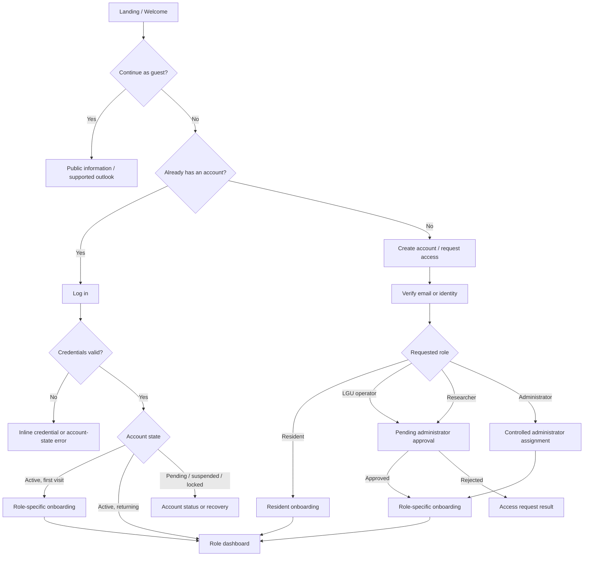

# RiverGuard UI/UX Design Cheat Sheet

> **Document purpose:** Complete product-flow and screen-planning reference for RiverGuard UI/UX design.
>
> **Status:** Design specification. It includes the current local research prototype and clearly labeled future concepts. It does not mean every screen is implemented.
>
> **Initial study coverage:** Quezon City, Marikina, Manila, and Pasig.

> **Current redesign direction (November 2026):** RiverGuard uses four product roles: Resident, LGU operator, Researcher, and Administrator. Researcher forecasting is being rebuilt as a dedicated workspace. New screens should first be validated under an isolated preview route before replacing the existing `/researcher/*` experience.

## 1. How to use this document

Use this cheat sheet when creating the sitemap, user flows, low-fidelity wireframes, design system, and high-fidelity Figma screens. It answers:

- Who uses RiverGuard?
- How does each person enter and leave the system?
- Which account, authentication, and onboarding screens are required?
- Which pages can each role access?
- What inputs, buttons, outputs, and states belong on each page?
- Which features belong to the initial prototype and which are future concepts?

### Design-status labels

| Label         | Meaning                                                                                                                       |
| ------------- | ----------------------------------------------------------------------------------------------------------------------------- |
| **Prototype** | Appropriate for the initial local research demonstration.                                                                     |
| **Optional**  | Useful for a richer prototype, but not necessary for the first usable design.                                                 |
| **Future**    | May be designed now, but requires more data, validation, authentication, infrastructure, or governance before implementation. |

## 2. Product rules that affect every screen

1. RiverGuard is a **research and decision-support prototype**, not an official warning authority.
2. The supplied development data is daily and city-level for Quezon City, Marikina, Manila, and Pasig.
3. Do not present city-level data as barangay-, street-, river-station-, or household-level evidence.
4. Do not claim real-time monitoring when the product is displaying historical records, requested weather forecasts, or experimental model results.
5. Results produced from unverified data must be labeled **Experimental**.
6. Static hazard susceptibility and dynamic forecast results require separate layers, legends, timestamps, and explanations.
7. Unsupported areas show **Unsupported** or **No prediction available**, never an assumed low-risk result.
8. Missing readings remain missing; the interface must not silently display them as zero.
9. Predictions do not replace PAGASA advisories, LGU procedures, professional assessment, or evacuation instructions.
10. Every result should expose its location, valid date, retrieval/creation time, source, model version, quality status, and limitations when available.

## 2A. Canonical premium visual direction

RiverGuard should feel like a premium environmental-intelligence product: calm, precise, spacious, and trustworthy. The visual reference is a map-led weather dashboard with an atmospheric blue backdrop, a large white application shell, restrained navigation, and clearly grouped analytical surfaces. Use the reference for hierarchy and mood, not for copied branding, copy, or unrelated weather widgets.

### Experience principles

1. **One dominant task per page.** The Researcher Forecast Workspace answers one question: what is the forecast, where is it, and why did the model produce it?
2. **Map first, evidence second.** The map is the largest visual surface. Prediction evidence sits beside and below it in a predictable reading order.
3. **Progressive disclosure.** Show the current result first. Detailed inputs, provenance, metrics, and limitations follow without competing for attention.
4. **One navigation system.** Researcher screens use one horizontal application header. Do not combine a top navigation with one or two sidebars.
5. **Premium through restraint.** Use generous whitespace, exact alignment, quiet borders, and strong typography. Avoid decorative clutter, excessive pills, glass effects, and dense admin-style card grids.
6. **Evidence is never decoration.** Every chart, status, and map layer must have a source, unit, valid time, and user purpose.

### 60–30–10 colour system

| Share   | Use                                                       | Direction                                                                                         |
| ------- | --------------------------------------------------------- | ------------------------------------------------------------------------------------------------- |
| **60%** | Application shell and content surfaces                    | White and very pale blue-white surfaces                                                           |
| **30%** | Atmospheric ground, navigation emphasis, and data context | Deep ocean blue through clear sky blue; subtle cloud texture is allowed outside the content shell |
| **10%** | Actions and semantic emphasis                             | Teal for primary actions; blue for rainfall; green, amber, and red only for risk/status meaning   |

The application shell must remain readable without the atmospheric background. Gradients belong to the outer ground or a single deliberate data treatment, not every card.

### Typography and density

- Use Geist as the application typeface.
- Use a confident page title, compact section titles, readable body text, and small metadata only for secondary evidence.
- Prefer sentence case. Avoid all-caps except short status labels such as `LIVE FORECAST`.
- Use tabular numerals for probabilities, rainfall, water levels, dates, and model metrics.
- Keep controls at least 44 px high and preserve visible keyboard focus.
- Research pages may be information-rich, but no section should look like an undifferentiated spreadsheet.

### Shape, depth, and iconography

- Use one soft radius scale across the shell, cards, controls, and charts.
- Use subtle borders before shadows; reserve the strongest shadow for the outer application shell.
- Keep content nesting to two surfaces deep.
- Use a consistent professional icon family. Do not use emoji as product icons or logos.
- Risk must never be communicated by colour alone; pair colour with text and, where useful, an icon.

### Motion

- Buttons may lift or brighten slightly on hover and compress on press.
- Charts may animate once when fresh data arrives, then remain still.
- Map and panel transitions should be quiet and functional.
- Respect `prefers-reduced-motion` and never animate every card on scroll.

### Explicitly avoid

- cartoon backgrounds or decorative illustrations;
- emoji-style logos;
- duplicate navigation or double sidebars;
- unrelated weather, air-quality, or station widgets;
- large collections of equal-weight cards;
- neon gradients, violet accents, or heavy glassmorphism;
- invented precision, unsupported map overlays, or unlabeled fixture data.

## 2B. Researcher information architecture

The dedicated Researcher experience has three destinations:

1. **Forecast Workspace** — run and understand the current seven-day forecast.
2. **History** — review stored forecast runs created by authorized roles.
3. **Model & Data Reference** — read how the current model, inputs, metrics, sources, and limitations work.

### Forecast Workspace composition

```text
Application header
    RiverGuard · Forecast Workspace · History · Model & Data Reference · account

Live forecast strip
    provider status · selected location · retrieved time · Run forecast

Primary split
    dominant map and location context | forecast overview

Seven-day forecast
    rainfall bars · probability line · threshold · daily risk labels

Evidence
    exact model inputs | why this prediction / sensitivity

Data status
    source · freshness · model version · quality · limitations
```

The map may show the selected city, verified boundaries, rivers, and hazard layers. A future multi-point Open-Meteo layer may be labelled **Rainfall context**. Do not call it a flood-risk heatmap. The current city-level model cannot produce a spatial ML-risk surface.

### History composition

History is a shared forecast-run record, not the 30-day weather history used as model input. It should show filters, creator/role, location, requested time, provider, model version, completion/quality status, highest risk, peak probability, and a compact selected-run preview. Visibility remains role-specific and must be enforced by the backend.

### Model & Data Reference composition

This page is read-only for researchers. It explains the active model version, feature schema, required inputs, operating threshold, data sources, performance reference, model limitations, and the meaning of probability and predicted water level. It is documentation and evidence, not model configuration.

### Responsive behaviour

- **Desktop:** horizontal navigation; map and forecast overview share the first content row.
- **Tablet:** keep the horizontal header compact; stack forecast overview below the map when necessary.
- **Mobile:** use a single-column reading order: status, result, map, seven-day outlook, inputs, explanation, provenance.
- Tables become labelled run cards or an accessible horizontal table with a deliberate overflow treatment.
- Every chart requires a readable table or textual alternative.

### Role reuse

Use shared forecast, map, provenance, and status components with role-specific detail:

| Component         | Researcher                     | LGU operator                      | Resident                    | Administrator                                     |
| ----------------- | ------------------------------ | --------------------------------- | --------------------------- | ------------------------------------------------- |
| Forecast result   | Full technical result          | Operational interpretation        | Plain-language summary      | System/audit view                                 |
| Seven-day outlook | Full chart and daily evidence  | Action-oriented outlook           | Simplified daily outlook    | Available for audit                               |
| Model inputs      | Full read-only values          | Important contributing conditions | Hidden                      | Full values                                       |
| Explanation       | Sensitivity charts and reasons | Short reasons                     | Plain-language explanation  | Full evidence                                     |
| History           | Authorized technical history   | Assigned-location history         | Own requests/public results | All runs                                          |
| Model reference   | Full read-only reference       | Summary                           | Hidden                      | Reference plus controlled configuration elsewhere |

### Safe implementation path

Build and validate the redesign under isolated preview routes before replacing production navigation:

```text
/researcher-preview
/researcher-preview/history
/researcher-preview/model-data
```

The preview must use real forecast and Convex responses where available. Mock values must be visibly identified and must not survive into the replacement routes.

## 3. Application roles and account policy

### 3.1 Product roles

| Role                       | Primary goal                                                                                                    | Initial availability       |
| -------------------------- | --------------------------------------------------------------------------------------------------------------- | -------------------------- |
| **Guest / Public Visitor** | View project information and supported public outlooks                                                          | **Public information**     |
| **Resident / Public User** | View a simplified location outlook and request an informational personal forecast                               | **Active / being refined** |
| **LGU / DRRMO Operator**   | Review assigned-location forecasts and prepare controlled operational communication                             | **Active / being refined** |
| **Researcher**             | Run forecasts, inspect complete model evidence, review shared history, and read model/data reference material   | **Dedicated redesign**     |
| **Administrator**          | Approve users, assign roles, configure supported locations/providers/models, and review system and audit status | **Active governance role** |

Product Owner, Scrum Master, and Development Team are project-delivery roles. They do not automatically need separate application roles. If they use the application, they receive one of the product roles above.

### 3.2 Recommended account rules

- Public information may be browsed without an account in a future hosted version.
- Residents may self-register only for resident features such as saved locations or notification preferences.
- A person must **not** gain LGU, Researcher, or Administrator permissions merely by selecting that role during sign-up.
- LGU and Researcher access use an access request that an administrator approves. Administrator access is assigned by an existing administrator or controlled setup.
- The first administrator is created through a controlled setup process, not public sign-up.
- Firebase provides email/password and Google authentication. SMS, OTP, password recovery, and multi-factor authentication are outside the current delivery scope.
- Firebase proves identity; Convex stores RiverGuard role, status, profile, and authorization data.

### 3.4 Capability boundaries

Research and governance are separate responsibilities even when one developer tests both roles:

- `research.read`
- `research.runForecast`
- `research.reviewModels`
- `governance.manageUsers`
- `governance.configureSystem`
- `governance.viewAudit`

Researchers receive the research capabilities only. Administrators receive governance capabilities and may inspect research records for auditing, but administration should not be presented as the primary research workspace.

### 3.3 Account states

| State            | Meaning                                    | User experience                                  |
| ---------------- | ------------------------------------------ | ------------------------------------------------ |
| Guest            | Not signed in                              | Public pages only                                |
| Unverified       | Registered but email/identity not verified | Verification screen; resend option               |
| Pending approval | Privileged-role request is awaiting review | Pending page; no protected workspace access      |
| Active           | Verified and approved where required       | Role workspace access                            |
| Rejected         | Access request declined                    | Neutral status page and support/contact option   |
| Suspended        | Temporarily blocked by an administrator    | Sign-in blocked with a non-sensitive explanation |
| Deactivated      | Account access removed                     | Sign-in blocked; contact administrator           |
| Locked           | Too many failed attempts or security event | Recovery/unlock guidance                         |

## 4. Complete entry, authentication, and onboarding flow



## 5. Authentication screen specifications

### AUTH-01 — Welcome / landing

**Status:** Optional for the local prototype; required for a future multi-role experience.

**Purpose:** Explain RiverGuard, provide public access, and route account holders into authentication.

**Content:**

- RiverGuard name and “Research Prototype” label
- Short description
- Current supported cities
- Safety and experimental-use notice
- Links to About, Methodology, Data Limitations, Privacy, and Terms when available

**Buttons:**

- `Explore as Guest`
- `Log In`
- `Create Account`
- `Request Staff Access`
- `Learn How RiverGuard Works`

### AUTH-02 — Log-in form

**Inputs:**

| Field                | Type     | Requirements                               |
| -------------------- | -------- | ------------------------------------------ |
| Email                | Email    | Required; normalize whitespace/case safely |
| Password             | Password | Required; show/hide control                |
| Remember this device | Checkbox | Optional; explain session effect           |

**Buttons and links:**

- `Log In`
- `Continue with configured identity provider` — **Future**, only if selected
- `Forgot Password?`
- `Create Account`
- `Request Staff Access`
- `Back to Public View`

**States/messages:**

- Invalid credentials: “The email or password is incorrect.” Do not reveal which field matched an account.
- Unverified account: `Resend Verification`
- Pending account: `View Request Status`
- Locked account: `Recover Account`
- Provider/network failure: retry without clearing the form unnecessarily
- Session expired: explain that the user must log in again; retain a safe return destination

### AUTH-03 — Resident sign-up form

**Status:** Future.

**Inputs:**

| Field                           | Type     | Notes                                                      |
| ------------------------------- | -------- | ---------------------------------------------------------- |
| Full name                       | Text     | Required                                                   |
| Email                           | Email    | Required                                                   |
| Password                        | Password | Required; display requirements before submission           |
| Confirm password                | Password | Must match                                                 |
| Primary city                    | Select   | Optional preference; show supported/unsupported status     |
| Accept Terms and Privacy Notice | Checkbox | Required when policies exist                               |
| Receive notifications           | Checkbox | Optional; off by default and separate from account consent |

**Buttons:** `Create Account`, `Already have an account? Log In`, and `Continue as Guest`.

**Success destination:** Email/identity verification.

### AUTH-04 — Staff access request

**Status:** Future. Used for LGU access. Administrator access is invitation-only.

**Inputs:**

| Field                                              | Type         | Notes                                                      |
| -------------------------------------------------- | ------------ | ---------------------------------------------------------- |
| Full name                                          | Text         | Required                                                   |
| Work email                                         | Email        | Required                                                   |
| Organization                                       | Text/select  | Required for LGU                                           |
| Requested role                                     | Fixed field  | LGU Operator only; administrator access is invitation-only |
| Assigned city/area                                 | Multi-select | Request only; does not grant access                        |
| Reason for access                                  | Text area    | Required; include character guidance                       |
| Reference/contact                                  | Text         | Optional; avoid unnecessary sensitive data                 |
| Terms, privacy, and authorized-use acknowledgement | Checkbox     | Required                                                   |

**Buttons:** `Submit Access Request`, `Save and Continue Later` — optional, `Cancel`, and `Log In`.

**Success destination:** Verification followed by Pending Approval.

**Safety rule:** Never include a public “Sign up as Administrator” option.

### AUTH-05 — Email or identity verification

**Status:** Future.

**Content:** masked destination, expiration guidance, and verification status.

**Inputs:** six-digit code if code verification is used. Support paste and automatic focus movement without blocking keyboard navigation.

**Buttons:** `Verify`, `Resend Code/Link`, `Change Email`, and `Back to Log In`.

**States:** sent, verifying, verified, invalid code, expired code, resend cooldown, and too many attempts.

### AUTH-06 — Pending approval

**Status:** Future.

**Content:** requested role, organization, submission time, current status, expected next step, and non-sensitive administrator note where appropriate.

**Buttons:** `Refresh Status`, `Edit Request` when still allowed, `Withdraw Request`, `Contact Administrator`, and `Log Out`.

### AUTH-07 — Forgot password

**Status:** Deferred and removed from the current authentication flow.

**Input:** account email.

**Buttons:** `Send Reset Link`, `Back to Log In`.

Always show a neutral success message whether or not an account exists.

### AUTH-08 — Reset password

**Status:** Deferred and removed from the current authentication flow.

**Inputs:** new password and confirm new password.

**Content:** password rules and link-expiration state.

**Buttons:** `Reset Password`, `Request New Link`, and `Back to Log In`.

**Success destination:** Password Reset Complete with `Continue to Log In`.

### AUTH-09 — MFA setup and challenge

**Status:** Future and outside the current delivery scope.

**Setup flow:** choose supported method → scan/register → enter test code → show recovery codes → confirm recovery-code storage.

**Challenge inputs:** authentication code or recovery code.

**Buttons:** `Verify`, `Use Another Method`, `Use Recovery Code`, and `Contact Administrator`.

### AUTH-10 — Invitation acceptance

**Status:** Future.

**Content:** inviting organization, assigned role, assigned locations, invitation expiration, and acceptable-use notice.

**Inputs:** name confirmation, password setup or provider login, and required acknowledgements.

**Buttons:** `Accept Invitation`, `Decline`, and `Report Incorrect Invitation`.

### AUTH-11 — Account problem screens

Create distinct screens for:

- Access request rejected
- Account suspended/deactivated
- Account locked
- Invitation expired
- Verification link expired
- Unauthorized role/permission
- Authentication service unavailable

Each screen must explain what happened without exposing security details and provide one appropriate next action.

## 6. Role-specific onboarding

### ONB-01 — Resident onboarding

1. Welcome and experimental-use explanation
2. Select primary city and optional additional locations
3. Choose notification and accessibility preferences
4. Explain official-advisory sources and limitations
5. `Go to My Outlook`

**Skip behavior:** preference steps may be skipped; safety/limitations acknowledgement should not be hidden.

### ONB-02 — Researcher orientation

1. Confirm profile and organization
2. Explain supported geography and data limitations
3. Explain the current model, inputs, and experimental status
4. Tour Forecast Workspace, History, and Model & Data Reference
5. Confirm responsible-use acknowledgement
6. `Go to Forecast Workspace`

### ONB-03 — LGU operator onboarding

1. Confirm organization and assigned city/area
2. Explain review versus official warning authority
3. Explain forecast-review and acknowledgement workflow
4. Explain internal notes and future alert-draft approval
5. Configure allowed notifications
6. Confirm authorized-use acknowledgement
7. `Go to LGU Dashboard`

### ONB-04 — Administrator onboarding

1. Verify organization and administrator assignment
2. Confirm account and security responsibilities
3. Review supported locations and role policy
4. Review weather-provider, model, and data-source configuration status
5. Review audit and user-approval responsibilities
6. Confirm security acknowledgement
7. `Go to Admin Dashboard`

## 7. Shared application shell

| Element              | Purpose                                | Required behavior                                                            |
| -------------------- | -------------------------------------- | ---------------------------------------------------------------------------- |
| Product identity     | Return to role home                    | Show “Research Prototype”                                                    |
| Role/workspace label | Clarify current permissions            | Example: `LGU Operator · Marikina`                                           |
| Primary navigation   | Access allowed sections                | Hide inaccessible destinations; do not rely only on hiding for authorization |
| Location selector    | Change active location                 | Display support status                                                       |
| Global status        | Show data/model/service condition      | Text plus icon/color                                                         |
| Notifications        | Show relevant system/review items      | **Optional/Future**                                                          |
| Help and limitations | Open definitions/methodology           | Available from every result page                                             |
| Account menu         | Profile, preferences, security, logout | Available after login                                                        |

### Account-menu items

- Profile
- Organization and assigned locations
- Notification Preferences
- Accessibility Preferences
- Security and Sessions
- Help and Limitations
- Switch Workspace — only for approved multi-role accounts
- Log Out

## 8. Navigation by role

### Resident

- Home / My Outlook
- Locations
- Seven-Day Outlook
- Hazard Context
- Saved Preferences
- Help and Limitations

### LGU operator

- Overview
- Risk Map
- Locations
- Forecast Outlook
- Review Queue
- Alerts and Notes — future

### Administrator

- System Overview
- Research tools
- Forecasts
- User Requests
- Users and Roles
- Supported Locations
- Data Sources
- Weather Provider
- Model Versions
- Hazard Layers
- Audit Log
- System Settings

## 9. End-to-end role flows

### 9.1 Guest/public flow

Landing → Explore as Guest → Select supported city → View simplified outlook or project information → Open hazard context → Open official source → Optionally create resident account.

If public hosting does not exist, this flow remains a future wireframe only.

### 9.2 Resident flow

Create account → Verify → Resident onboarding → Select/save city → View seven-day outlook → Open a day → Read experimental status and limitations → View static hazard context separately → Review the official-source reminder → Adjust preferences → Log out.

### 9.3 Researcher flow

Create account/request Researcher access → Verify identity → Administrator approval → Researcher onboarding → Open Forecast Workspace → Select location → Run forecast → Inspect seven-day result, model inputs, explanation, and quality → Review shared History → Read Model & Data Reference → Log out.

### 9.4 LGU operator flow

Request access/invitation → Verify → Administrator approval → LGU onboarding → Open assigned-area dashboard → Review latest run and quality warnings → Inspect day/location details → Acknowledge review → Add internal note → Escalate for official assessment when needed → Prepare alert draft in a future phase → Authorized approval outside/inside defined workflow → Log out.

### 9.5 Administrator flow

Controlled administrator assignment/setup → Verify → Admin onboarding → Review pending access requests → Approve/reject and assign locations → Check supported-location configuration → Review provider/model status → Review audit log → Suspend/deactivate an account when authorized → Log out.

## 10. Core product screens

### APP-01 — Role dashboard

**Common outputs:** supported locations, latest data/forecast time, quality warnings, service status, recent activity, and coverage map.

**Researcher buttons:** `Run Forecast`, `Open History`, `View Model & Data Reference`.

**LGU buttons:** `Review Latest Forecast`, `Open Assigned Area`, `Open Review Queue`.

**Resident buttons:** `View My Outlook`, `Change City`, `View Hazard Context`.

**Administrator buttons:** `Review Access Requests`, `Manage Locations`, `Review System Status`, `Open Audit Log`.

### APP-02 — NCR map and location explorer

**Controls:** location search/select, date/forecast-day select, layer panel, legend, zoom, reset, details drawer, and accessible list alternative.

**Layers:** boundaries, supported-city coverage, verified waterways, static hazard susceptibility, experimental forecast result, and verified stations when available.

**Buttons:** `Reset View`, `View Location Details`, `Open Forecast Details`, and `View as List`.

Static hazard and forecast layers must never share an ambiguous combined legend.

### APP-03 — Location details and historical data

**Filters:** location, date range, variable, and data source.

**Outputs:** support summary, chart, table, units, resolution, missing-data markers, provenance, and limitations.

**Buttons:** `Apply Filters`, `Reset`, `View Source`, and optional licensed `Download Displayed Data`.

### APP-04 — Run experimental forecast

| Input               | Control                    | Rule                                                    |
| ------------------- | -------------------------- | ------------------------------------------------------- |
| Locations           | Multi-select               | Supported locations only                                |
| Horizon             | Select/segmented           | Up to seven days; extended-outlook label where required |
| Issue/start period  | Read-only/current          | Historical dates require backtesting mode               |
| Weather provider    | Read-only/admin-configured | Show provider                                           |
| Model version       | Compatible select          | Administrator research tools only                       |
| Include explanation | Checkbox                   | Only for supported model                                |

**Buttons:** `Review Inputs`, `Run Experimental Forecast`, and `Cancel`.

**Validation:** unsupported location, incompatible model, missing required features, provider failure, and unavailable verified station data.

### APP-05 — Forecast progress

Steps: requesting weather → validating inputs → running supported models → saving snapshot → complete/partial/failed.

**Buttons:** `Run in Background` — optional, `Cancel Run` only if safely supported, and `View Partial Details` after partial completion.

### APP-06 — Forecast results

**Header:** run ID, status, times, locations, provider, model version, and quality status.

**Outputs:** seven-day cards, weather inputs, experimental index/category, supported water-level output, evaluated uncertainty, feature contributions, warnings, and explicit unavailable results.

**Buttons:** `View Day`, `View Explanation`, `Compare Run`, `Open on Map`, `Add Review Note`, and future `Export Report`.

Never call an uncalibrated output an exact flood probability.

### APP-07 — Forecast-day detail

Show location/date, result, rainfall/available inputs, relevant historical comparison, explanation, uncertainty, quality notes, separately labeled hazard context, and official-source reminder.

**Buttons:** `Previous Day`, `Next Day`, `View on Map`, and `How Was This Estimated?`.

### APP-08 — Forecast history and comparison

**Filters:** location, run dates, valid date, model, and status.

**Columns:** run ID, created time, location, horizon, model, provider, status, and warnings.

**Buttons:** `View Run`, `Compare Selected`, `Clear Selection`.

### APP-09 — Data-source catalog and metadata form

**Catalog outputs:** name, provider, license, geography, time coverage, resolutions, variables, provenance, and limitations.

**Form fields:** source name, provider, type, source URL/reference, license, access date, coverage, interval, resolution, units, measurement method, local file reference, citation, provenance status, and limitations.

**Buttons:** `View`, optional `Add Source`, `Edit Metadata`, and future `Validate Dataset`.

### APP-10 — Models and evaluation

Show model/version, responsibility, target, supported locations/horizons, features, dataset version, validation method, metrics, calibration status, model card, limitations, and readiness.

**Buttons:** `View Model Card`, `View Evaluation`, `Compare Versions`, and controlled future `Set as Demo Model`.

### APP-11 — LGU review queue and review form

**Queue columns:** run/location, valid period, quality status, review status, assigned reviewer, updated time.

**Review form:** run ID, reviewer, time, review status, notes, supporting reference, follow-up owner, and follow-up status.

**Buttons:** `Start Review`, `Save Draft`, `Mark Reviewed with Limitations`, `Escalate for Official Assessment`, and `Cancel`.

### APP-12 — Alert draft and approval

**Status:** Future; only after stakeholder validation.

**Fields:** affected area, valid period, severity, summary, supporting run/evidence, official reference, recommended-action text, approver, intended channels, and expiration.

**Flow:** Draft → Request approval → Authorized review → Approve/reject/return for revision → Publish through an explicitly approved channel → Expire/archive.

**Buttons by state:** `Save Draft`, `Request Approval`, `Return for Revision`, `Approve`, `Reject`, `Publish`, `Cancel`, and `Archive`.

Publication is a separate, high-consequence action and must never occur automatically from a model result.

### APP-13 — User requests and role assignment

**Status:** Future administrator screen.

**Request details:** identity, organization, requested role/locations, reason, verification state, submitted time, and audit history.

**Administrator inputs:** approved role, permitted locations, decision note, and optional expiration/review date.

**Buttons:** `Approve`, `Reject`, `Request More Information`, `Assign to Reviewer`, and `Cancel`.

### APP-14 — Users and roles

**Table:** name, organization, role, status, assigned locations, and last access.

**Actions:** `Invite User`, `Edit Access`, `Suspend`, `Reactivate`, `Deactivate`, and `View Activity`.

Destructive or security-sensitive actions require clear confirmation and audit recording.

### APP-15 — Configuration screens

#### Supported location

Fields: name/ID, representative coordinates, support status, variables, compatible models, boundary asset, assigned operators, and limitation message.

#### Weather provider

Fields: provider, product/endpoint, variables, units, timezone behavior, request limits, attribution, credential status, and enabled status. Never reveal stored secrets.

#### Model version

Fields: name/version, responsibility, artifact ID, input schema, locations, horizons, validation reference, status, and activation note.

#### Hazard layer

Fields: name, source, license/attribution, geography, return period/classification, version/date, local asset, and visibility status.

### APP-16 — Audit log

**Status:** Future.

**Filters:** actor, action type, date, affected resource, and outcome.

**Outputs:** timestamp, actor, action, resource, before/after summary where appropriate, and result. Sensitive values and secrets must be redacted.

## 11. Profile, settings, security, and exit flows

### SET-01 — Profile

Fields: full name, organization, contact email, role (read-only unless administrator), assigned locations (read-only for non-admin), and optional profile preferences.

Buttons: `Save Changes`, `Cancel`, and `Request Access Change`.

### SET-02 — Notification preferences

**Status:** Future.

Controls: product updates, review assignments, system status, experimental outlook updates, delivery channel, quiet hours, and location subscriptions. Each category requires a clear opt-in/out rule.

### SET-03 — Accessibility preferences

Controls may include increased contrast, reduced motion, text-size guidance, chart table alternative, and default map/list view.

### SET-04 — Security and sessions

Show password last changed, active sessions/devices when available, and recent security activity.

Buttons may include `Change Password`, `Log Out Other Sessions`, and `Report Suspicious Activity` when supported by the authentication provider.

### SET-05 — Change password

Inputs: current password, new password, confirm new password. Show rules before submission and preserve accessible error focus.

### SET-06 — Log out

Account menu action → end session → return to landing/login → show “You have been logged out.” Do not lose unsaved form work without warning.

### SET-07 — Delete resident account / deactivate staff account

**Status:** Future.

- Resident deletion: explain data-retention impact, require reauthentication, explicit confirmation, and final success state.
- Staff/admin accounts: use administrator-controlled deactivation rather than self-deleting records needed for audit history.

## 12. Route and permission matrix

| Area                       | Guest |                    Resident |                   LGU |                   Researcher |         Admin |
| -------------------------- | ----: | --------------------------: | --------------------: | ---------------------------: | ------------: |
| Public About/Limitations   |  View |                        View |                  View |                         View |          View |
| Simplified public outlook  |  View |                        View |                  View |                         View |          View |
| Run informational forecast |    No |                Own location |        Assigned areas |              Supported areas |           Yes |
| Forecast history           |    No | Own requests/public results |    Assigned locations | Authorized technical history |      All runs |
| Detailed model inputs      |    No |                          No |               Summary |                    Read-only |          View |
| Model & Data Reference     |    No |                          No |               Summary |                    Read-only |          View |
| Review queue               |    No |                          No |                   Yes |                           No |          View |
| Alert draft                |    No |                          No | Future assigned users |                           No | Future manage |
| User/role management       |    No |                          No |                    No |                           No |           Yes |
| System configuration       |    No |                          No |                    No |                           No |           Yes |
| Audit log                  |    No |           Own activity only |     Assigned activity | Own/shared research activity |  All activity |

The backend must enforce permissions. Hiding navigation items is not sufficient authorization.

## 13. Reusable components

| Component             | Required information                                                         |
| --------------------- | ---------------------------------------------------------------------------- |
| Account-status banner | Status, impact, next action                                                  |
| Role/workspace badge  | Role and assigned organization/location                                      |
| Location card         | Name, support status, latest result, updated time, warnings                  |
| Forecast-day card     | Date, weather summary, experimental result, uncertainty/status, action       |
| Status badge          | Text plus color/icon; never color alone                                      |
| Data-quality banner   | Problem, affected outputs, user impact, next step                            |
| Provenance panel      | Provider, observation/retrieval time, units, coverage, citation, limitations |
| Model card            | Version, purpose, coverage, validation, limitations                          |
| Chart                 | Variable, unit, range, source, missing markers, table alternative            |
| Map legend            | Layer name, meaning, run/date, static/dynamic label                          |
| Empty state           | What is unavailable, why, and what can happen next                           |
| Confirmation dialog   | Exact action, consequence, confirm/cancel controls                           |
| Stepper               | Current authentication/onboarding/forecast step                              |
| Toast/notification    | Brief result; never the only place critical information appears              |

## 14. Required system and form states

Design all important screens/forms for:

- Default
- Hover/focus/active
- Filled/selected
- Inline validation error
- Submission loading
- Success
- Partial success
- Empty/no data
- Unsupported
- Stale
- Experimental
- Provider/network error
- Local ML service offline
- Convex save error
- Authentication required
- Permission denied
- Session expired
- Account pending/suspended/locked

Forms must preserve valid input after recoverable failures, identify errors next to fields, provide an error summary when useful, and move keyboard/screen-reader focus appropriately.

## 15. Terminology and content guidance

### Prefer

- Experimental forecast or outlook
- Experimental risk index/category
- Static hazard susceptibility/context
- Supported location
- Data-quality warning
- Forecast valid for
- Retrieved at / observed at
- No prediction available
- Escalate for official assessment

### Avoid until genuinely supported

- Real-time river monitoring
- Live flood map
- Exact flood probability
- Barangay-level prediction
- Guaranteed safe
- Official RiverGuard warning
- Automatic evacuation warning
- NCR-wide coverage

### Standard safety notice

> RiverGuard provides experimental research outputs for decision support. Check PAGASA and your LGU for official advisories and evacuation instructions.

## 16. Figma frame checklist

### Authentication and account

1. Welcome / Landing
2. Log In — default, error, loading
3. Resident Sign Up — default, validation, success
4. Staff Access Request — default, validation, success
5. Verify Email/Identity — default, invalid, expired
6. Pending Approval
7. Request Rejected
8. Forgot Password
9. Reset Password — default, expired, success
10. MFA Setup
11. MFA Challenge
12. Invitation Acceptance
13. Session Expired
14. Unauthorized / Account Suspended / Locked

### Onboarding

15. Resident Onboarding
16. LGU Onboarding
17. Administrator Onboarding

### Core application

18. Administrator Research Workspace
19. LGU Dashboard
20. Resident Outlook
21. Administrator Dashboard
22. NCR Map / Location Explorer
23. Location Details
24. Historical Data
25. Run Forecast
26. Review Forecast Inputs
27. Forecast Progress
28. Forecast Results
29. Forecast Day Detail
30. Forecast History
31. Compare Forecast Runs
32. Data Sources
33. Data-Source Form
34. Models and Evaluation
35. Model Card
36. LGU Review Queue
37. Forecast Review Form
38. Alert Draft
39. Alert Approval
40. User Access Requests
41. Users and Roles
42. Location/Provider/Model/Hazard Configuration
43. Audit Log

### Settings and states

45. Profile
46. Notification Preferences
47. Accessibility Preferences
48. Security and Sessions
49. Change Password
50. Logout Success
51. Delete/Deactivate Account
52. Loading, empty, unsupported, stale, experimental, partial, offline, and error state variants
53. Component and design-token sheet

## 17. Recommended design order

1. Sitemap and route/permission matrix
2. Authentication and account-state flow
3. Role-specific onboarding
4. Shared shell and navigation
5. Researcher Forecast Workspace and core forecast journey
6. Map, location, data-source, and model-detail screens
7. LGU review and future alert-approval journey
8. Resident simplified journey
9. Administrator approval and configuration journey
10. Profile, security, logout, and account lifecycle
11. All empty, error, unsupported, permission, and responsive states
12. Reusable components, content rules, and accessibility annotations

The recommended first connected prototype is:

**Welcome → Log In → Researcher Workspace → Run Forecast → Review Seven-Day Result → Open History → Open Model & Data Reference → Log Out.**

After that path works, adapt the shared forecast, map, provenance, and status components for Resident, LGU, and Administrator views instead of designing four unrelated products.
